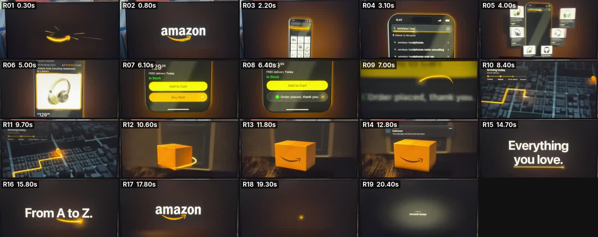

# 01. 레퍼런스 분석 — "Amazon · From A to Z" (riki.bosso)

- 원본: https://www.instagram.com/reel/DeezVQit345/ (2026-10-14 게시, 21.5s, 720×1280 / 30fps 업로드본)
- 형식: 9:16 릴스. 창가 책상 위 모니터 안에서 16:9 광고가 재생되고, 노트북에는 편집 타임라인이 열려 있다.
  상단 오버레이 `OPUS 5.5 + KATANA = 🤯`, 하단 `Prompt Below ⬇️`.
  → **우리가 따라갈 대상은 "모니터 안의 16:9 광고"** 자체다.
- 제작자 공개 프롬프트(PDF "From A to Z – The Prompt")를 함께 분석했다. 아래 §3.

---

## 1. 장면별 분석 (모니터 안 광고 기준, 초)

| # | 구간 | 화면 | 모션 / 연결 방식 | 역할 |
|---|---|---|---|---|
| R01 | 0.00–0.23 | 깊은 공간에서 주황 빛줄기가 카메라로 돌진 → 스마일 위치에 **슬램** | 프레임 0부터 이미 움직임. 셰이크 + 파편 + 서브 히트 | **훅**: 0.2초 안에 읽히는 단 한 번의 큰 타격 |
| R02 | 0.23–1.60 | 스마일 위로 `amazon` 워드마크가 a→z 방향으로 드러남, 로고 정지 | 빛이 스마일 아래를 a→z로 훑으며 마스크 리빌 | 브랜드 각인 |
| R03 | 1.60–2.40 | 로고가 위로 빠지고, 빛 사본이 떨어져 나와 아이폰 테두리가 됨 | 폰이 박자(2.40)에 착지 | 로고 → 제품 **핸드오버** |
| R04 | 2.40–3.30 | 앱 검색창 `wireless headphone` 타이핑 + 실제 자동완성 행 | 빛 = 검색창 포커스 라인 | "검색 한 번" |
| R05 | 3.40–4.40 | 결과 카드 6장이 화면에서 3D로 떠올라 부채꼴로 펼쳐졌다 정착 | 실제 깊이감, 카메라 푸시 | 선택의 풍요 |
| R06 | 4.40–5.30 | 상품 상세: 사진, 별점, `$129.99` | 카드 1 → 상세로 줌 | 제품 리얼리티 |
| R07 | 5.30–6.00 | `FREE delivery Today / In Stock / Add to Cart / Buy Now` | 빛 = Buy Now 버튼의 채움(fill), 뜨거운 머리 = 진행 끝 | "원 탭" |
| R08 | 6.00–6.70 | `Order placed, thank you.` + 녹색 체크 | 탭(클릭+성공 차임) | 즉시 보상 |
| R09 | 6.70–7.20 | 빛이 화면 밖으로 튀어나가고 카메라가 화면을 **관통** | 줌 블러 | 디지털 → 물리 세계 전환 |
| R10–11 | 7.20–10.00 | 밤의 도시를 위에서 → 3/4 뷰로 스웁. 빛이 도로를 따라 경로를 그림, 집 핀. 좌상단 글래스 카드 `Arriving today` 4단계 트래커 | 블록이 솟아오름, 디포커스로 다이브 | "이미 오는 중" — 물류 역량 |
| R12–13 | 10.00–12.30 | 현관 앞, 크래프트 박스. 빛이 바닥을 타고 와 박스를 한 바퀴 감고 **정면에 스마일로 착지** → 빛이 잉크로 식음 | 박스가 "door" 박자에 착지 | 물리적 결과물 + 브랜드 낙인 |
| R14 | 12.30–13.30 | iOS 알림 `Delivered · Your package was left at the front door.` | 알림 팝 | 신뢰의 마침표 |
| R15 | 13.30–15.00 | `Everything you love.` — 시즌 스윕, `love`만 주황, 밑줄 | 글자 채움 → 흰색으로 정착 | 감성 약속 |
| R16 | 15.00–16.50 | `From A to Z.` — 화살표가 A 밑에서 Z 밑까지 달려가 스마일처럼 휘어짐 | **로고 의미의 회수** | 아하 모먼트 |
| R17 | 16.50–19.20 | 숨 고르기(음악 아웃) → 16.80 히트에 화살표가 공식 스마일로 슬롯인, 워드마크 a→z 재리빌. 아래로 느린 빛 | 로고 홀드 → 디포커스, 화살표 빛이 점 하나로 | 히어로 엔딩 |
| R18–19 | 19.20–21.20 | 점 → 흰 선 → 스포트라이트 속 서명 `made by riccardo bosso` | | 엔드카드 |

**리듬**: 19.2s(=100BPM 8마디) + 2s 엔드카드. 비트 하나 ≈ 2.4s(1마디). 오디오 RMS 피크(0.3 / 2.7 / 6.9 / 9.0 / 11.4 / 13.8 / 15.0 / 17.1s)가 장면 전환과 정확히 일치.

---

## 2. 매력 포인트 (우리가 반드시 가져갈 것)

1. **로고의 의미 = 스토리.** 스마일은 원래 a→z 화살표. 그 한 줄이 검색·구매·배송·박스·태그라인을 전부 수행하니, "아마존"이라고 말하지 않아도 아마존으로 읽힌다.
2. **한 줄의 빛, 하나의 함수.** 모든 씬이 같은 빛을 다음 씬에 넘긴다 → 19초가 한 테이크처럼 느껴짐. 하드컷 0.
3. **훅은 한 방.** 첫 박자에 큰 슬램 하나. 이펙트 난사가 아님.
4. **고객 여정의 압축.** 찾기 → 고르기 → 한 번 누르기 → 오는 중 → 도착 → 알림. 제품 가치가 UI의 실제 문구(`FREE delivery Today`, `Arriving today`)로 증명됨.
5. **물리적 결과물.** 디지털 여정이 손에 잡히는 박스로 끝나고, 그 위에 브랜드가 찍힌다.
6. **어두운 무대, 밝은 주인공.** 거의 검정 배경 + 숨 쉬는 웜 글로우 + 단 하나의 액센트 컬러. 주인공(폰·박스·타이포)은 크고 밝다.
7. **미니멀 카피.** 화면 카피는 마지막 두 줄뿐. 강조색은 한 줄에 한 단어만.
8. **진짜처럼.** 베벨, 테이프, 그림자, 실제 자동완성 행. 스켈레톤 바·평평한 큐브는 즉시 가짜로 읽힘.

---

## 3. 공개 프롬프트(PDF)에서 확인한 제작 원칙

| 항목 | 원본 프롬프트 | 이번 ClassIn 작업 적용 |
|---|---|---|
| 제작 방식 | 100% 코드 렌더(Python 2.5D, numpy/Pillow/OpenCV). AI 영상 생성 없음 | 100% 코드 렌더(결정론적 HTML/SVG/Canvas 2.5D 렌더러 → Playwright 프레임 캡처 → ffmpeg) |
| 포맷 | 19.2s + 2s 엔드카드, 60fps, 16:9 + **진짜 9:16 리레이아웃(크롭 아님)** | 동일 원칙: 60fps, 16:9 마스터 + 9:16 리레이아웃 |
| 연출 | 원 테이크, 하드컷 0, 카메라는 항상 드리프트, 긴 이징, 강한 모션블러, 얕은 심도 | 동일. 서브프레임 모션블러, 씬 간 플라이스루 핸드오버 |
| 룩 | #070707 무대, 숨 쉬는 앰버 글로우, 코너 보조색, 파인 그레인, 액센트 1색 | #050806 무대, 숨 쉬는 그린 글로우, 딥그린(#0b3d2b) 코너, 그레인, 액센트 = ClassIn 그린 |
| 라인 | 한 줄의 빛이 모든 일을 하고 **하나의 공유 함수**로 그린다 | `js/line.js`의 `drawLine()` 하나로 모든 씬의 빛을 그림 |
| 브랜드 | 공식 로고만 사용, 이동/스케일/페이드/마스크만 허용, 재작도·재색상 금지, 정지 시 픽셀 정확, 위에 아무것도 그리지 않음. 가상의 상품·상점 | 공식 ClassIn PNG를 그대로 사용(마스크로만 분할). 학원명·인물·데이터는 전부 가상 |
| 보이스 | ElevenLabs 내레이션, 라인별 시작 시간 고정, 보이스 먼저 → 타임라인 고정 | 한국어 VO 대본 + 타임코드 확정(04 문서). 믹서에 VO 슬롯 구현(파일만 넣으면 자동 배치) |
| 음악 | 코드로 만든 오리지널, 100BPM(1마디 2.4s), 드롭에서 킥, 히어로 전 숨 고르기 | 코드로 합성한 오리지널, 100BPM 그리드에 모든 비트 정렬 |
| 사운드 | 약 90개 큐, 보이는 모든 움직임에 소리. 마스터 −14 LUFS / −1.25 dBTP | 합성 SFX(슬램·타이핑 틱·스와이프·클릭·차임·휘시·핑·알림) 전부 타임라인 이벤트에 동기 |
| 프로세스 | 리서치 → 프레임 단위 브리프 → 보이스 → 병렬 빌드 → 프리뷰/컨택트시트/프레임 체크 → 수정 1회 → 최종 포맷 | 동일 순서로 진행, 기록은 05_revision_log.md |
