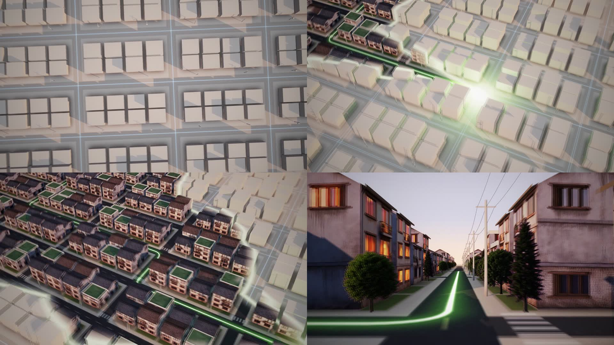

# 04. 수정 · 디벨롭 로그

리뷰 방법(원본 프롬프트의 PROCESS 5 그대로): 결정론적 렌더러라 아무 시점이나 즉시 뽑을 수 있다 →
**0.5s 간격 컨택트시트(53장)** 로 전체 흐름 점검 → 문제 구간만 **스틸 클로즈업** → 수정 → 재확인.
풀 렌더 후에는 **프레임 간 차이(움직임 에너지) 그래프**로 팝/튐/계단식 모션블러를 찾는다.

---

## v0 → v1 · 빌드 중 발견한 문제

| # | 증상 | 원인 | 수정 |
|---|---|---|---|
| 1 | 콘솔 씬 카메라가 기기 좌상단만 비춤 | 숨겨진(`display:none`) 씬에서 레이아웃을 측정해 좌표가 전부 0 | 측정 시 모든 씬을 잠깐 표시하고 `layout()` 호출 (`film.js`) |
| 2 | 맵의 배포 경로가 "분수"처럼 과하게 솟음 | 아치 높이 `40 + d·0.28` | `10 + d·0.11`로 낮추고 소형 지점은 얇고 어둡게(위계) |
| 3 | 맵 → 교실 전환에서 맵의 빛줄기가 블러 없이 남음 | 빛은 전역 캔버스라 씬의 블러/페이드 필터를 받지 않음 | 맵 페이드 구간을 앞당기고(10.42–10.80) 다이브 플레어 축소 |
| 4 | "전 지점에 배포"와 "배포되었습니다"가 겹쳐 보임 | 크로스페이드 구간 중첩 | 라벨은 먼저 빠지고(−0.04→+0.05) 성공 문구는 뒤에 들어오게 분리 |
| 5 | 태그라인 · 엔드카드 글자가 폰에서 작음 | 112px / 40px | 148px / 54px, 서브라인 31px, 엔드카드 로고는 240px 원본 크기(픽셀 정확) |

## v1 → v2 · 전체 컨택트시트 리뷰

| # | 구간 | 증상 | 수정 |
|---|---|---|---|
| 1 | 0.00 | **훅이 약함** — 프레임 0이 화면 중앙의 작은 점 | 접근 경로를 카메라 가까이로 당기고(머리 시작 30% 지점), 가닥 3개 굵기·진폭 확대, 꼬리에 빛 먼지 26개. 프레임 0부터 큰 혜성이 화면을 가로지름 |
| 2 | 0.16 | 슬램 직전 꼬리가 올가미처럼 말림 | 접근 곡선의 마지막 제어점을 베이스라인과 평행하게 → 매끈하게 화살표로 합류 |
| 3 | 0.70–1.05 | 정지한 로고 위에 i-점 잔광이 남음 (브랜드 규칙 위반) | 잔광을 1.02s 전에 완전히 소거 → 정지 구간은 공식 로고만 |
| 4 | 17.0–18.0 | 태그라인 글자가 탁하고 회색 (어두운 UI 이미지로 글자 채움) | 이미지 채움 폐기 → 줄 단위로 **그린-화이트 빛 밴드가 스윕**하고 순백으로 정착 |
| 5 | 8.4–10.4 | 도트맵이 어둡고 작아 한국 지형이 잘 안 읽힘 | 도트 알파 0.42→0.58, 크기 3.4→3.9, 카메라 스케일 0.84→0.96 |
| 6 | 5.6–6.6 | 배포 버튼이 화면 중앙 + 하단 절반이 빔 | 버튼을 하단 1/3로, 위쪽은 체크된 지점 리스트가 채우도록 카메라 타깃 이동 |
| 7 | 6.03 | 탭 리플이 흰 덩어리처럼 글자를 가림 | 리플을 얇은 링 + 약한 채움으로 |

## v2 · 9:16 리레이아웃 (크롭 아님)

가로 UI를 세로 화면에 그대로 넣으면 화면의 1/3만 차지 → 세로판 전용 카메라 키를 따로 설계.

| 씬 | 16:9 | 9:16 |
|---|---|---|
| 콘솔 타이핑 | 기기 전체 + 입력창 (s 1.36) | 입력창 왼쪽 + 자동완성만 크게 (s 1.9) |
| 카드 팬 | 가로로 넓은 부채꼴 | 세로로 좁은 부채꼴 (FAN 좌표 별도) |
| 배포 버튼 | s 1.8 | s 2.35, 버튼 하단 1/3 |
| 전국 맵 | 트래커 좌상단, 맵 우측 | 트래커 상단 중앙, 맵이 하단 2/3를 꽉 채움 (한국 지형은 원래 세로형) |
| 교실 | 패널 전체 | 판서 쪽으로 밀착 (s 1.42, x −230) |
| 16개 교실 월 | 4×4 전체 | 2.5열이 화면을 넘치게 → "끝없이 이어지는 교실" |
| 대시보드 | 전체 | KPI + 차트 좌측 밀착 (s 1.2) |
| 태그라인 | 148px | 108px, 같은 2줄 |
| 엔드카드 | 1줄 | "1,000개 이상의 다지점 학원이 / 선택한 교육 운영 시스템" 2줄 |

## v2 → v3 · 클라이언트 피드백: "부드러운 프레임 · 고급스러운 연결 · 고객과의 연결이 감정으로 로고까지"

### ① 부드러운 프레임 — 프레임 차이 분석으로 검증
렌더된 60fps 영상의 연속 프레임 차이(움직임 에너지)를 전 구간 측정. 부드러운 언덕 = 긴 이징, 뾰족한 봉우리 = 튐/컷.

| 구간 | v2 측정 | 원인 | v3 수정 |
|---|---|---|---|
| 0.17 | 봉우리 | 의도된 슬램(훅) | 유지 |
| **7.267** | **유일한 튐 (diff 14.4, 이웃 6.4)** | 콘솔 씬이 7.25에 꺼지면서 플래시·관통 빛줄기가 1프레임에 사라짐 | 씬 범위 7.36까지 연장, 빛줄기·플레어를 7.12–7.34에 걸쳐 소멸 |
| 14.9–15.05 | 작은 튐 | 교실→대시보드에서 수렴선이 씬 종료와 함께 사라짐 | 14.90–15.03 페이드 |
| 16.95 | 빠른 푸시가 급정지 | 대시보드가 최고 속도에서 꺼짐 | 16.55부터 깊은 블러로 먼저 빠지고, 빛 머리가 다음 씬으로 이어짐 |
| 21.60 | 봉우리 | 의도된 히어로 히트 | 유지 |
| 파일 | 130MB (38Mbps, 그레인) | | 그레인 7→4, CRF 19 + VBV 10Mbps 상한 |

### ② 고급스러운 연결 — 빛이 끊기는 곳을 없앰
| 이음매 | v2 | v3 |
|---|---|---|
| 맵 → 교실 | 부산 플레어가 꺼지고, 0.4초 뒤 화면 밖에서 새 빛이 들어옴 | **다이브 지점(화면 중앙)에서 빛이 그대로 이어져** 패널 밑으로 빠졌다가 감기 시작 |
| 대시보드 → 태그라인 | 차트 머리로 푸시 후 암전, 1.4초 뒤 밑줄에서 빛 재등장 | 차트의 빛 머리가 중앙에 남아 **1행·2행 글자를 한 단어씩 써 나가고**, 그대로 `안으로` 밑줄이 됨. 시즌 밴드는 빛의 위치를 따라감 |
| 교실 → 대시보드 | 수렴선이 씬과 함께 툭 사라짐 | 플레어로 모인 뒤 페이드 |

### ③ 고객과의 연결 → 감정 → 로고
v2는 감정의 정점(학생 정답, 12.0s)이 로고(21.6s)에서 너무 멀고, 그 사이를 데이터 화면이 채웠다.

| 추가한 비트 | 시간 | 의도 |
|---|---|---|
| **트로피 보상** — 정답 밑줄에서 불꽃이 학생 타일로 날아가 금빛 트로피 +1 (ClassIn 고유 기능), 카메라가 학생에게 다가감 | 12.08–12.75 | 시스템 이야기가 **한 아이**에게 도착하는 순간 |
| **학부모 알림** — "지후가 오늘 수업에서 트로피를 받았어요"가 본사 알림 아래로 쌓임 | 13.88 | 같은 순간이 **본사와 가족** 모두에게 — 고객(학원)의 고객(학부모)까지 연결 |
| **연결선 수렴** — 숨 고르기 동안 사방에서 34개의 빛줄기가 `i` 점으로 모임 | 21.02–21.60 | 영상 속 모든 연결(지점·교실·학생·가족)이 **로고로 모이는 감정의 들숨** → 히트에서 터짐 |
| **엔드카드 카피** "본사와 지점, 선생님과 학생을 하나로." | 24.4– | 정보(1,000+)는 서브로 내리고, 마지막 문장은 연결의 약속 |
| VO 대본 | — | "그리고 한 아이의 순간까지." / "모두, 하나로 연결됩니다." 추가 |

## v3 → v4 · 클라이언트 피드백: "초록은 포인트만 · ClassIn 실제 소스/앱 UI 반영 · 교실·학생·가족·미래를 잇는 스토리"

### ① 초록은 포인트 컬러로만
v3까지는 무대 글로우·코너·UI 패널·도트맵·플래시가 모두 초록 계열이라 화면 전체가 초록으로 덮였다.

| 요소 | v3 | v4 |
|---|---|---|
| 무대 | #050806 + 초록 글로우 + 딥그린 코너 | **#0A0A0B 뉴트럴 차콜** + 장면별 색온도 글로우(교실 뉴트럴 쿨 / 집 앰버 / 미래 새벽빛), 슬레이트 코너 |
| 교실 UI | 초록빛 칠판 | ClassIn 공식 화면의 **차콜 칠판**(#2A2A2D), 회색 좌석 |
| 앱 UI | 다크 그린 콘솔 | ClassIn 앱의 **화이트 UI** (어두운 무대 위 밝은 주인공) |
| 도트맵 | 초록 도트 | 뉴트럴 그레이 도트, 빛이 닿으면 흰색 |
| 보조색 | 없음 | ClassIn UI에서: 정답 **주황**, 손들기 **노랑**, 트로피 **금색**, 학생 판서 **하늘색**, 감사 **핑크** |
| 초록이 남은 곳 | 전부 | 빛 한 줄 · 공식 로고 · `수업 입장` 버튼 · 정답 체크 · `안으로` 한 단어 |

### ② ClassIn 실제 제품 UI 반영
레포의 기존 이미지(범용 AI 대시보드·뇌 이미지)는 ClassIn 제품이 아니어서, ClassIn 공식 사이트(classin.com/teachers, 홈)의 제품 화면과 공식 기능 설명을 조사해 **코드로 다시 그렸다**(사진·이미지는 사용하지 않음, 인물은 모두 가상의 일러스트).

| ClassIn 공식 화면/기능 | 영상 속 재현 |
|---|---|
| 차콜 칠판 + 상단 영상 좌석 + 우측 세로 툴바 | S3 교실 전체 레이아웃 |
| 무대(Stage)에 학생을 크게 올림, 활성 초록 테두리 | 지후의 타일이 좌석에서 칠판 위로 |
| 퀴즈 결과: 막대 A–D, 정답 주황, Accuracy, Submission | 답변기 Q1 · 정답률 83% · 제출 6/6 |
| 트로피 보상(시상대, 금·은·동) | 선생님 → 지후 트로피 +1, 좌석 트로피 수 |
| 손들기 · 판서 권한 · 다중 페이지 칠판 · 클라우드/타이머/주사위 도구 | 노란 손, `판서 권한` 배지, 페이지 탭 1·2·3·+, 툴바 아이콘 |
| 수업 녹화 라이브러리 · 출석/수업활동/과제 데이터 · 학부모 리포트 | 학부모 리포트(출석·답변기·발표·트로피·코멘트·다시보기·성장 기록) |

### ③ 스토리라인 재구성 — 본사 시스템 → 교실 · 학생 · 가족 · 미래
| v3 (본사 중심) | v4 (사람 중심) |
|---|---|
| 본사 콘솔에서 커리큘럼 배포 | **지후의 폰**: 오늘의 수업, 선생님·친구 입장, `수업 입장` |
| 전국 배포 경로 | (뒤로 이동) **모든 교실에서 솟는 빛기둥** — 한 아이의 이야기가 전국의 이야기가 됨 |
| 교실 + 16개 교실 월 | **ClassIn 교실**: 판서 → 답변기 → 손들기 → 무대 → 직접 풀이 → 트로피 |
| 본사 대시보드 | **가족**: 엄마의 폰, 리포트, 선생님 코멘트, 다시보기, 감사 인사 |
| — | **미래**: 72 → 80 → 88 → 오늘 → 미분 → 고3 → 지후의 꿈 |
| "모든 수업을, 하나의 시스템 안으로." | **"교실에서 시작된 배움을, 아이의 미래 안으로."** (교실 → Class, 안으로 → In) |
| "본사와 지점, 선생님과 학생을 하나로." | **"교실과 학생, 가족과 미래를 잇다."** |

빛의 역할도 사람을 따라간다: 선생님의 펜 끝 → 지후의 펜 끝 → 트로피 → 엄마 폰의 알림 → 감사의 하트 → 미래의 경로 → 모든 교실의 빛기둥 → 태그라인을 쓰는 빛 → 로고.

### v4 빌드 중 수정
| 증상 | 수정 |
|---|---|
| 21.6s 이후 Class + In이 보이지 않음 | 태그라인 씬이 v3 타이밍(21.5s)에 꺼지던 것을 히어로 비트 기준으로 |
| 폰 → 교실 전환에서 두 화면이 반투명하게 겹침 | 폰 화면이 먼저 차콜로 어두워지며 프레임을 채우고, 교실은 그 안에서 맺히도록 순서 분리 |
| 교실 → 가족에서 지후 얼굴 위로 폰이 겹침 | 교실이 10.18s에 완전히 빠진 뒤 가족 시작, 이음매는 빛(불꽃)이 담당 |
| 트로피가 지후의 얼굴을 가림 | 타일 오른쪽 위로 이동 |
| "제출 6/6"이 세로로 줄바꿈 | flex 정렬 |
| 리포트 하단이 비어 보임 | **지후의 성장 기록**(72 → 88, 점선 '다음') 추가 — 다음 미래 씬을 미리 암시 |

### v4 최종 검증 — 프레임 차이 분석

- 1,728프레임(28.8s × 60fps), 튐 검출 **1곳: 0.167s = 의도된 슬램 훅**. 그 외 모든 움직임은 언덕형(긴 이징) 곡선.
- 흰 카드가 어두운 화면에 들어오는 두 지점(5.85s 답변기, 10.95s 리포트 열림)이 상대적으로 날카로워 페이드 0.12→0.27s, 슬라이드 0.38→0.52s(inOutCubic)로 완화 후 해당 구간만 재렌더.
- 60fps 고정(avg_frame_rate 60/1), 라우드니스 −14.1 LUFS. 트루피크가 −0.1 dBTP로 높아 loudnorm 뒤에 리미터(−1.5 dB) 추가.

---

## v4 → v5 · 클라이언트 피드백: "로고를 코드로(질감·텍스처) · 책 → 뇌 → 상상력 → 각 가정 · 아이보리 + 연두"
- 로고를 공식 글리프 외곽선(`assets/logo-paths.js`)으로 캔버스 렌더하는 `brandmark.js` 신설: 브랜드 그린 몸체 + 연두 빛 그라데이션, 안료 그레인(멀티 옥타브 노이즈), 새틴 베벨(인너 섀도/하이라이트), 종이 위 접지 그림자, 스펙큘러 시인, 외곽선 트레이스(i → C) + `i` 점에서 번지는 잉크. `a`의 카운터가 채워지던 문제는 even-odd 규칙으로 해결.
- 무대를 종이 결 아이보리로, 빛 한 줄(`LineFX`)을 밝은 배경용으로 재조정.
- 책 → 뇌 → 상상(로켓·토성·고래·나무·종이비행기) → 마을의 창문 → 창문 안 ClassIn 수업 → 태그라인 → 코드 로고로 전면 재구성.

## v5 리뷰 · "렌더링·질감이 훨씬 싸 보인다"
| 원인 | 설명 |
|---|---|
| 빛이 빛나지 않음 | 밝은 배경에서는 가산 발광이 사라져 빛 한 줄이 그냥 연두 선이 됨 — 원본의 핵심 매력 상실 |
| 재질 부족 | 평평한 CSS 집, 만화풍 큰 얼굴, 파스텔 면 → 클립아트 톤 |
| 밀도 | 작은 요소가 너무 많음(뇌 속 단어, 작은 그림, 집 100채) |
| 대비 | 아이보리 위 파스텔이라 전체가 뿌옇게 보임 |

→ 3가지 방향 제안(① v4 품질 기준 + 엔딩만 아이보리 ② 프리미엄 라이트 + AI 하이브리드 ③ 섞기: 어둠 → 빛). **클라이언트 선택: ③, 16:9만 먼저.**

## v5 → v6 · 「한 아이의 질문」 × 「어둠 → 빛」
- **스토리**: 주인공(서윤)의 질문 하나가 끝까지 끌고 감. 궁금함 → 몰입 → **막힘(고래가 흩어짐)** → ClassIn 수업에서 **질문이 선생님에게 갔다가 반 친구들과 함께 그린 답으로 돌아옴** → 고래가 창밖 새벽 하늘로 → 아이보리 브랜드 엔딩.
- **톤**: 앞 2/3는 v4의 어둠 속 발광 품질, 수업에서 따뜻해지고, 새벽에 밝아져 엔딩은 아이보리 + 연두. 빛 한 줄 모듈에 밤(가산)/낮(종이 위) 블렌드(`fx.light`) 추가, 무대 배경·비네트·종이 결도 시간에 따라 전환.
- **빛이 닿는 곳만 밝음**: 첫 장면은 화면 공간의 "빛 웅덩이" 레이어가 빛의 위치를 따라감(펜 끝 → 물음표 → 넘어가는 페이지 모서리 → 읽는 빛).
- **손글씨**: 한글 손글씨 폰트(Nanum Pen Script, OFL)를 영상에 쓰인 글자만 서브셋(62KB)으로 포함.
- **ClassIn 수업 장면**: v4에서 좋았던 차콜 교실 UI를 1920×1080으로 다시 설계 — 영상 좌석, 손들기, 채팅, 다중 판서(학생별 펜 색 + 이름표), 판서 도구, 트로피. 태블릿 유리에 그대로 맵핑되어 카메라가 "화면 속으로" 들어갔다 나옴.
- **막힘 연출**: 고래 선이 깜빡이다 점으로 흩어지고, 음악 전체가 22%로 내려앉았다가 태블릿이 켜지는 순간 복귀.
- 만화풍 큰 얼굴(v5 실내 장면) 제거 — 인물은 수업 영상 타일 안에서만.

### v6 빌드 중 수정
| 증상 | 수정 |
|---|---|
| 태블릿으로 들어갈 때 수업 화면이 유리에서 떨어져 떠 보임 | 카메라가 태블릿 유리를 화면에 꽉 채울 때까지(s 3.05, 회전 보정) 실제로 다가가고, 화면 맵핑 보간은 마지막 0.14초에만 |
| 질문의 빛이 태블릿 중앙에 떨어진 뒤 서윤 타일로 순간이동 | 빛의 착지점을 서윤 타일의 실제 위치로 |
| 반 친구들의 낙서가 영상 좌석 위로 넘침 | 칠판 안에서 고래 위치를 내리고 낙서 배치를 다시 잡음 (날개 위, 풍선 오른쪽, 구름 양옆, 별) |
| 낙서가 연두로만 보임 | 빛이 식는 시간을 당기고 잉크 폭을 키워 학생별 펜 색이 보이게 |
| 새벽 장면 좌상단의 회색 사각형 | 카메라에 너무 가까운(렌즈 뒤로 넘어가는) 집을 숨김 |
| 뇌 사이를 카메라가 지나갈 때 큰 글자가 스쳐감 | 뇌를 다이브 시작 0.3초 안에 퇴장 |

---

## v6 → v7 · 원본 재분석 + 이미지 생성 하이브리드 + "집집마다 → 전국" 복원
**피드백**: "집이나 다른 것들은 이미지 생성으로 만들어졌다 · 원본처럼 퀄리티 높은 3D 그래픽 · 예산 $20 · 배경과 요소를 따로 · 집집마다, 전국으로 퍼지는 맨 처음 내용 살리기 · 최고의 포텐셜로"

### 제작 방식 — 원본과 같은 레이어 구조
| 레이어 | v7 |
|---|---|
| 생성 플레이트 | 밤의 방 벽(밤/새벽 2장, 같은 구도 편집), 새벽 하늘·산맥, 안개 낀 마을 원경, 구름 바다(고고도) |
| 생성 질감 | 호두나무 책상, 스프링 노트 페이지, 종이 |
| 생성 오브젝트 (누끼) | 집 12채(한옥·주택·빌라), 나무·가로등, 스탠드·화분·연필꽂이·책 더미 — 마젠타 배경 생성 → `render/key.py`로 키잉·디스필·분리 |
| 코드 | 빛 한 줄, 코드 로고, ClassIn 수업 UI, 트래커 카드, 한반도 도트맵(실제 행정경계), 알림, 손글씨, 태그라인 |
| 공간 | 모든 플레이트·스프라이트를 같은 2.5D 카메라 공간에 배치 → 패럴랙스 |

- `render/gen.py`: Gemini 이미지 API(gemini-3-pro-image 2K / gemini-3.1-flash-image), 매니페스트, 호출마다 `render/gen_log.json`에 토큰·예상 비용 기록. **총 16회 호출, 예상 약 $1.36** (2회는 모델 필터로 거절 — 과금 없음).
- `render/prep.py`: 원본(raw, 로컬 보관)을 영상용 크기로 축소·압축.

### 구조 — 원본 문법 그대로
| 원본 | v7 |
|---|---|
| 0.2초 슬램 → 로고 리빌 → 로고의 빛이 제품이 됨 | 연두 혜성이 `i` 점에 슬램 → 코드 로고 리빌 → **`i` 점의 빛이 떨어져 공책 위 펜 끝** |
| 검색 → 카드 → 구매 | 질문(손글씨) → 책 → **읽은 단어들이 고래 모양으로** → 막힘 → ClassIn 수업(질문 → 함께 → 답) |
| 화면 관통 | 고래가 태블릿을 뚫고 방으로 → **실제 창문**으로 |
| 밤의 도시 + `Arriving today` | **새벽 마을** + 글래스 카드 `오늘의 수업 · 질문 → 함께 그리기 → 답 → 리포트` |
| (v4/v5 피드백 복원) | **한반도 도트맵 위로 번지는 빛** — `전국 1,000+ 다지점 학원 · 오늘도, 집집마다 수업 중` |
| 박스 위 스마일 낙인 | 아침 공책 — 서윤이 그린 답 + **물음표의 점이 ClassIn `i` 점 도장**으로 |
| `Delivered` 알림 | `ClassIn 학부모 · 오늘의 수업 리포트가 도착했어요` |
| A→Z 화살표가 스마일로 | `함께` 밑줄의 빛이 휘어 올라 로고의 `i` 점 자리로 |

### v7 빌드 중 수정
| 증상 | 원인 / 수정 |
|---|---|
| 공책 손글씨가 보이지 않음 | 전국 지도 도시 라벨 클래스(`.nl`)가 공책 줄 클래스와 충돌해 opacity 0 → `.ncity`로 분리 |
| 떠오른 단어들이 장면이 끝난 뒤에도 남음 | 단어 레이어가 씬 섹션 밖에 있어 범위 밖에서 숨겨지지 않음 → 끝까지 관리하도록 |
| 창문으로 들어갈 때 벽이 천장처럼 보임 | 카메라를 rx 52° → 88°로 들어 벽을 정면으로 보며 창문 속으로 |
| 마을 창문 불빛이 큰 얼룩처럼 보임 | 플레어 크기 상한(110px), 강도 낮춤 |
| 전국 지도가 노란 원반처럼 뭉침 | 도트 반지름 축소(점 간격 대비), 미점등 점은 더 작고 흐리게 |
| 아침 도장이 물음표 전체를 지움 | 물음표는 남기고 점만 덮은 뒤 기울어진 `i` 점을 찍음 |
| 아침 장면의 세운 소품이 납작하게 눌려 보임 | 위에서 내려다보는 각도에서는 소품 제거 |
| 단어가 너무 작아 읽히지 않음 | 고래 위 단어 스케일 0.26–0.55 → 0.42–0.85 |

---

## v7 → v7.1 · 진짜 고래 + 훨씬 빠르게
**피드백**: "구성은 생각보다 괜찮다. 코드로 만든 고래 외관이 너무 고래스럽지 않다. 60프레임 기준으로 움직이는 속도, 빛이 가는 속도가 훨씬 더 빨라야 한다."

### 고래 — 생성 이미지 질감 + 그 이미지에서 추출한 윤곽선
| | v7 | v7.1 |
|---|---|---|
| 상상의 고래 (책 위) | 코드 곡선으로 그린 윤곽선만 | **생성 이미지: 빛으로 된 혹등고래**(반투명, 내부 빛결·입자). 빛이 윤곽을 그리면 **머리 → 꼬리로 실체화**, 헤엄(꼬리로 갈수록 커지는 파동), 반짝이 입자가 흩날림. 멈출 때 깜빡이며 **몸 전체가 빛 입자로 부서져** 떨어짐 |
| 윤곽선 | 손으로 찍은 좌표 | `render/whale_trace.py`가 **이미지 실루엣을 자동 추적**(무어 경계 추적 → 스무딩 → 리샘플) → 빛이 그리는 선과 그림이 정확히 일치. 턱선·가슴지느러미·눈은 그림에서 읽어 추가 |
| 새벽 비행 | 선으로 그린 고래 | **생성 이미지: 3D 혹등고래**(마젠타 배경 → 누끼). 창문을 지나며 빛 섬광과 함께 "진짜"가 됨 — 함께 그린 상상이 실체가 되는 순간. 도윤이의 **빛 날개가 펄럭이고**, 빛줄기는 꼬리지느러미에서 흘러나옴 |
| 칠판 → 방 → 창문 | 선 고래가 뒤로 날아감 | 칠판에서 헤엄쳐 나온 고래가 방에서는 **다시 빛 고래 이미지**로, 진행 방향을 보고 고개를 든 채 창문으로 (빛 날개 펄럭임) |
| 칠판·노트 낙서 | 이전 곡선 | 같은 추적 윤곽선 사용 (칠판의 부력 화살표는 지느러미와 겹치지 않게 이동) |

- 이미지 2장 추가(gemini-3-pro-image 2K): 누적 예상 비용 **약 $2.83** (이미지 18회 ≈ $1.63 + Veo 테스트 1회 ≈ $1.20).
- `src/js/whalepic.js`: 그림을 캔버스로 그려 4px 열마다 파동만큼 밀어 "헤엄" — 선과 그림이 같은 파동 함수를 공유.
- 빛 고래는 검은 배경 이미지를 **밝기 = 알파**로 변환해 어떤 배경 위에서도 빛처럼 합성.

### 속도 — 전체 시간 워프
- 장면·비트는 그대로 두고, 필름 시간이 이야기 시간을 **부드러운 단조 3차 곡선(PCHIP)** 으로 재생: `timeline.json` `meta.warp`.
- **28.8초 → 21.0초.** 움직임 구간 1.45–1.6배(오프닝·단어/고래·친구들/비행/전국/아침), 읽는 구간 1.2배(수업 UI·태그라인·엔드카드). 속도 변화가 연속이라 구간 경계에서 튀지 않음.
- 장면 안의 모든 하드코딩 시간(빛 이동, 그리기, 깜빡임)이 함께 빨라짐 — 빛 이동 예: 로고 → 공책 0.75 → 0.47초, 고래 윤곽 0.75 → 0.52초, 새벽 비행 3.25 → 약 2.2초, 전국 확산 1.45 → 약 0.97초.
- 음악 100 → **120 BPM**. 렌더러가 필름 시간 비트(`out/beats.json`)를 내보내고, `audio.py`는 이야기의 마디를 가장 가까운 박에 맞춰 코드 진행을 배치. 드롭·멈춤·태블릿·리프트·태그라인·숨·히어로가 모두 박 위에 옴. 효과음 큐도 같은 워프로 매핑.

### v7.1 검증
- 1,260프레임 · CFR 60fps · 21.0초 · **−14.0 LUFS**, 피크 −0.9 dBFS.
- 모션 검사: 고래가 떠오를 때 책상이 15% 밝기에서 한 프레임에 사라지던 컷 → 고래 아래로 부드럽게 페이드. 남은 플래그는 의도한 것뿐(0.1초 슬램, 책장 넘김의 연속 고속 움직임, 멈춤 깜빡임, 태블릿 밖으로 빠지는 9.7–9.9초 고속 카메라).

---

## v7.1 → v8 · 수업을 더 즐겁게 (사람 장면 없음, 24초)
**피드백 흐름**: 원본처럼 시선을 잡는 인트로 · 폰 → 주문 같은 명확한 제품 이야기(폰 알림 → 태블릿 → 펜 → 필기) · 고래는 살린다 · 사람 없는 버전 · "수업을 더 즐겁게" · 태그라인 A · 질감 고급화(패드·아이들·집·칠판 선) · 원본처럼 덩어리에서 집으로(집 장면만 카메라 전환 방식)

| 마디 | 시간 | 장면 | 만드는 방법 |
|---|---|---|---|
| 1 | 0.0–2.0 | 3D 폰이 회전하며 날아와 정면에서 멈추는 순간 알림 슬램 `오늘은 상상 퀴즈 수업!` → [입장하기]를 빛이 채움 → 탭 | three.js (깎인 금속 바디, 유리, 룸 환경광), 잠금화면 캔버스 텍스처 |
| 2 | 1.5–3.7 | 폰이 고무처럼 늘어나며 가로로 돌아 태블릿 → 3D 펜이 드럼스틱처럼 돌며 들어와 탭 → 퀴즈 판서 → 화면 속으로 다이브 | 교실 화면은 캔버스 하나(`classui.js`) — 3D 태블릿의 텍스처와 방의 태블릿 화면이 같은 캔버스라 다이브 끝에서 이음새 없이 전환 |
| 3 | 3.6–6.0 | 선생님이 고래를 그림 → **빨리 답하기**: 타일에 불이 돌다가 "딩! 1등" (도윤) | 생성 일러스트 얼굴 6명, 잉크 칠판(펜 압력·그림자·결), 수업 도구 패널 |
| 4 | 6.0–8.0 | **각자 칠판**: 네 친구의 작은 칠판이 튀어나와 박자마다 날개·풍선·구름·별 (+ 타이머) | |
| 5 | 8.0–10.0 | 작은 칠판들이 선생님의 고래에 착착 붙음 → **트로피** → 빛이 완성된 그림을 훑음 → 빛 고래가 칠판 위에서 실체화 | v7.1 빛 고래 이미지 |
| 6 | 10.0–12.0 | 카메라가 태블릿 밖으로 빠지면 방 — 고래가 떠올라 공중에서 몸을 돌리고 빛 날개·풍선을 달고 창문으로 | |
| 7 | 11.6–14.0 | **고정된 클레이 마을** 위로 카메라가 지나가는 사이 3D 고래가 이끄는 빛의 면이 마을을 텍스처로 칠함 → 휩 → 거리 앵글, 창마다 불 | 4K 집 + 클레이/불 켜진 편집본, 카메라만 움직임 |
| 8 | 14.0–16.0 | 전국 지도 | v7.1 재사용 |
| 9 | 16.0–17.5 | 다음 날 아침, 책상 위 3D 폰에 리포트 알림 `퀴즈 3개 정답, 트로피 2개를 받았어요 🏆` (첫 알림과 같은 소리) | three.js, 낮은 햇빛 그림자 |
| 10 | 17.5–19.5 | 수업이 **즐거우면**, / 생각이 **날아오른다**. | |
| 11–12 | 19.55–24.0 | 펜이 회전하며 올라와 로고의 i 자리에 섬 (펜촉 = i의 사선 끝, 펜 끝의 빛 = i의 점) → 히트 → 로고 → 엔드카드 `즐거운 수업 하나가, 전국 모든 집으로.` | |

- 음악 120 BPM, 12마디(24초). 효과음 91개, 리포트 알림은 첫 알림과 같은 소리로 수미상관.
- 마감: 인코딩 단계 필름 그레이딩(할레이션 + S커브 + 비네트 + 그레인).
- 구조: `gl.js`(three.js 레이어, 결정론적 프레임 렌더), `classui.js`(교실 캔버스), `scenes/devices.js`·`room.js`·`whale.js`·`dawn.js`·`morning.js`, `whalegeo.js`(고래 형상 분리). v7.1의 책·공책·단어 장면은 제거.

### v8 빌드 중 수정
| 증상 | 원인 / 수정 |
|---|---|
| [입장하기]가 채워지지 않음, 교실 빛 트레이스가 히어로까지 이어짐 | 타임라인 비트 이름이 겹쳐(fillB·traceB) 뒤의 값이 앞을 덮음 → `btnA/B`, `lightA/B`로 분리 |
| 고래가 떠오를 때 빛 날개가 화면을 가로지르는 긴 선으로 보임 | 카메라에 너무 가까이(260) 솟아 원근이 과장됨 → 130으로 낮추고, 카메라는 더 빨리 빠지며(중간 키 추가) 몸 돌리기는 늦게 |
| 별이 퀴즈 글씨를 가림 | 별 위치 이동 |

### v8 검증
- 1,440프레임 · CFR 60fps · 24.0초 · **−14.2 LUFS**, 트루피크 −1.6 dBTP (AAC 인코딩 후 피크가 넘쳐 리미터를 0.84 → 0.76, loudnorm TP −2.2로 조정).
- 모션 검사: 튀는 프레임 없음. 표시된 곳은 모두 의도한 빠른 전환 — 탭 섬광(1.37초), 태블릿 밖으로 빠지기(10.0초), 창문 통과(11.7초), 마을 휩(13.25초), 아침으로 전환(15.9초). 다이브 끝 3D → 교실 화면 전환(3.72초)은 흔적 없음.
- 그레이딩: 밝은 아이보리 엔딩에서 비네트가 모서리를 칙칙하게 해 PI/5.5 → PI/7.5로 약하게.
- 렌더 시간: 3D 구간은 소프트웨어 WebGL이라 서브프레임당 약 1초 — 전체 약 56분(워커 3).

---

## v8.1 룩 테스트 — 집: 바둑판 블록 → 집 (본편 미반영)

피드백: "집이 더 기하학적 정렬 · 원본처럼 블럭으로 되어 있다가 바뀌는 형태"

 · 움직임: [`storyboard/lookdev_town_v81.mp4`](storyboard/lookdev_town_v81.mp4) (3초, 마을 구간 11.6–14.6)

| 항목 | 내용 |
|---|---|
| 왜 바꾸나 | v8의 집은 원근이 그림에 박힌 2D 스프라이트라 줄을 세워도 카메라가 돌면 선이 안 맞음 → 진짜 3D로 다시 지음 |
| 배치 | 바둑판 도로(블록 4필지 × 2열, 도로 8m), 같은 크기·방향·간격, 2층/3층, 박공지붕 75% · 평지붕(녹색 방수 옥상) 25% — 640채 |
| 블록 → 집 | 처음엔 창도 지붕도 없는 클레이 블록 + 원본처럼 도로에 빛줄. 빛이 도로를 따라 직각으로 꺾이며 지나가면, 경로에서 바깥으로 퍼지는 경계선을 따라 평평한 윗면이 박공지붕으로 접혀 올라가고(0.22초, 반동 없음) 클레이가 실제 외벽 재질로 바뀐 뒤 창에 불. 집은 고정, 움직이는 건 지붕과 카메라뿐 |
| 재질 | 새 생성 없이 기존 4K 빌라 시트에서 벽면 네 모서리를 잡아 원근 보정(호모그래피)한 정면·측면 외벽 + 같은 구도의 불 켜진 버전으로 창 불빛 추출, 기와 경사면도 같은 방식. 중간층을 잘라 2층 변형 (`render/facades.py` → `src/assets/gen/town/`) |
| 골목 | 전봇대·전선(바뀐 뒤에만 보임), 마당 나무(낮은 앵글에서만), 경로 빛은 길 위에 남아 소실점까지 |
| 카메라 | 부감(바둑판) → 3/4 뷰 스윕 → 휘익 휩 → 골목 낮은 앵글 → 수직 상승 |
| 코드 | `src/js/town.js`(마을·셰이더·카메라), `src/dev/town.html`(룩 테스트 페이지) |

- 이미지 생성: Gemini 선불 크레딧 소진(402)으로 새 이미지 없이 진행 — 추가 비용 $0.
- 남은 일(본편 반영 시): 고래·트래커 카드 얹기, 크레인업 구간 서브프레임 늘리기(지금은 2장이라 빠른 상승에서 잔상), 마을 → 전국 지도 매치컷.

---

## v8.1 — 본편 반영: 3D 마을 · 펜 움직임 · 움직임에서 만든 효과음

피드백: "본편 반영하고 펜이랑 효과음도" (기획: 펜 움직임 더 자연스럽게 + 자연스러운 효과음)

### 마을 (11.5–14.6, 길이 그대로)
| 시간 | 장면 |
|---|---|
| 11.6 | 창문을 통과하면 바로 내려다본 바둑판 블록 마을(클레이 + 도로 빛줄) |
| 12.0 | 고래의 빛이 거리로 떨어짐(착지 섬광 + 낮은 '쿵') → 도로를 따라 직각으로 꺾이며 반 친구 집까지 |
| 12.0–13.0 | 경로에서 퍼지는 경계선을 따라 블록이 집으로(지붕 접힘 · 외벽 · 창 불), 카메라는 부감 → 3/4 뷰 · 고래가 빛 위를 남 · 트래커 카드 |
| 12.95 | 도착한 집이 초록으로 빛남 |
| 13.1–13.4 | 휩 → 골목 낮은 앵글, 경로 빛은 길 위에 남아 소실점까지 |
| 13.4–14.0 | 창마다 불(가까운 집 → 먼 집), 고래가 골목 위로 날아감 |
| 14.0–14.6 | 수직 상승, 고래와 함께 하늘로 → 구름 위 전국 지도로 크로스페이드 |

- `scenes/dawn.js`는 `js/town.js`를 감싼 장면으로 교체. 고래는 마을 3D 안에 카메라를 보는 평면(헤엄치는 캔버스 텍스처), 빛 날개·꼬리는 2D 빛으로 화면 위치에 맞춰 그림.
- 마을만 노출 0.9로 그리고 되돌림(다른 3D 장면은 그대로). 렌더러: 마을 구성에 시간이 걸려 페이지 준비/첫 프레임 대기 시간을 늘림.

### 펜
| 구간 | v8 | v8.1 |
|---|---|---|
| 등장 | 세 축을 동시에 여러 바퀴 굴러옴 | 한 축으로 한 바퀴, 회전이 지수적으로 감속하며 호를 그리고 내려앉음 · 태블릿이 내려앉자마자(0.4초 당김) 탭 |
| 필기 | 일직선 등속 + 사인파로 통통, 글씨는 혼자 써짐, 몸통 각도 고정 | 글자마다 한 번의 획(최소 저크 속도), 글자 사이 들림·띄어쓰기에서 더 높이, **잉크는 펜촉이 지나간 자리만**. 몸통은 스프링-댐퍼에 매달린 윗부분 → 펜촉을 한 박자 늦게 따라가며 기울고 착지 때 살짝 흔들림. "오늘의 퀴즈:"는 인쇄체 라벨, 펜은 질문 한 줄만 씀 |
| 퇴장 | 쓰다가 떠남 | 끝까지 쓴 뒤 살짝 눌렀다가 들어 올리며 가속, 다이브(0.25초 압축)와 함께 빠짐 |
| 히어로 | 6바퀴 등속 회전 후 정지 | 다섯 바퀴 회전이 감속하며 정수 바퀴로 끝나고, 감쇠 스프링으로 약 3° 넘쳤다가 서서 i에 착지 |

- 펜촉 경로 하나(`makeQuizPen`)를 칠판 잉크 · 3D 펜 · 소리가 함께 씀. 리그는 렌더 순수성을 지키려고 매 프레임 `T.penIn`부터 960 Hz로 다시 적분.
- 비트: penIn 2.25 → 1.95, penTap 2.85 → 2.42, quiz 2.9–3.55 → 2.47–3.32, diveA 3.05 → 3.3 (dive 3.72 그대로).

### 효과음 (움직임에서 합성)
| 소리 | v8 | v8.1 |
|---|---|---|
| 펜촉 착지 | 3 kHz 사인 "삐" | 모달 합성 '톡': 플라스틱 공진 4개(3–10 ms 감쇠) + 태블릿 몸체(190·420 Hz). 첫 착지는 단단하게, 글자마다 작은 톡, 들어 올릴 때 아주 작은 틱, 히어로에서 i에 꽂히는 톡(히트와 겹침 허용) |
| 필기 | 박자와 무관한 랜덤 노이즈 | 렌더러가 내보낸 펜촉 트랙(접촉·속도)으로 마찰음: 크기·밝기가 속도를 따라가고 빠를수록 스틱-슬립 알갱이가 촘촘 |
| 펜 비행 | 주파수만 훑는 휘익 | 실제 속도에서 나온 바람 소리 + 회전 각도에 맞춘 반 바퀴마다의 휙(등장 1바퀴, 히어로 5바퀴 감속) |
| 칠판 그리기·고래 선·밑줄 | 랜덤 노이즈 | 획 단위 속도 곡선으로 만든 마커(펠트) 마찰음 |
| 블록 → 집 | 없음 | 빛이 각 집에 닿는 시간(화면에 보이는 집만, 30 ms 묶음)마다 작은 나무블록 '탁' 연쇄, 3층 위주면 낮게, 위치에 따라 좌우 |
| 빛 착지 | 없음 | 낮은 '쿵' + 공기 |

- 큐: `js/cues.js`(펜 트랙 · 마을 데이터 → 큐), 합성: `render/audio.py`(`tok` · `scribble` · `penfly` · `clack` · `land`).

### v8.1 검증
- 1,440프레임 · CFR 60fps · 24.0초 · **−14.2 LUFS**, 샘플 피크 −1.1 dBFS. 효과음 136개(이 중 마을 나무블록 32개, 펜 착지 톡 13개).
- 모션 검사: 한 프레임만 튀는 곳은 탭 섬광(1.37초, 의도) 하나. 빠른 움직임 구간은 모두 의도한 카메라 이동 — 태블릿 밖으로(10.0), 창문(11.6–11.7), 마을 부감 → 3/4 스윕(12.37–12.57), 휩(13.2–13.33), 수직 상승 → 지도(14.05–14.25), 아침(15.9). 3D 태블릿 → 교실 화면 전환(3.72초)은 흔적 없음.
- 렌더 시간: 약 75분(워커 3) — 마을 3D가 서브프레임당 약 1.6초.

---

## v8.2 — 사진 없는 색 블록 마을 · 공식 갈매기 앱 아이콘 · 브랜딩 강화

피드백: "집 사진은 빼기, 회색에서 색이 들어서는 블록으로 · 앱에서 클래스인(갈매기 로고) 앱 알림으로 변경, 본질(강조) 브랜딩 강화 · 더 다듬자"

### 마을: 회색 → 색
| | v8.1 | v8.2 |
|---|---|---|
| 집 | 생성 이미지에서 보정한 외벽·기와 사진 + 지붕 접힘 | **사진 없음.** 2–4층 상자 블록 그대로, 빛이 지나간 자리부터 색이 들어섬 |
| 색 | 사진 재질 | 친구들의 펜 색을 부드럽게 한 하늘·복숭아·분홍·버터 + 크림, 경로를 따라 반 친구들 집은 ClassIn 민트, 빛이 도착한 집은 ClassIn 그린 |
| 디테일 | 사진 창문, 전봇대·전선, 사진 나무 | 색이 들어설 때 생기는 창문 그리드(층마다, 70%가 불 켜짐), 옥상 코니스·바닥 띠, 둥근 나무(회색 → 초록), 가로등(색과 함께 켜짐) |
| 회색 모델 | 베이지 클레이 | 중성 회색(햇빛도 덜 붉게) + 원본의 도로 빛줄 |
| 크레인업 | 빠른 상승에 잔상 | 처음은 느리게 시작해 가장 빠른 구간이 구름 위 지도로 넘어가는 크로스페이드 아래에 오도록 |

- `render/facades.py`와 `src/assets/gen/town/`(사진 텍스처) 삭제. `js/town.js`는 블록 하나의 메시와 셰이더(회색 → 색, 창문 그리드, 빛)로 단순해짐.

### 브랜딩
| 위치 | 변경 |
|---|---|
| 훅 (0–0.84) | **공식 ClassIn 앱 아이콘(갈매기)** 이 빛줄기를 타고 어둠에서 날아와 0.22초 비트에 휴대폰 앞에서 멈춤(파편·섬광) → 광택이 훑고 → 알림 칸으로 날아가 앉음(0.84, '톡'), 알림 카드가 그 주위로 열림 |
| 오프닝 알림 | 아이콘 그림 대신 공식 앱 아이콘, 앱 이름 굵게 |
| 아침 리포트 | 같은 아이콘, 앱 이름 "ClassIn"으로 통일 |
| 트래커·전국 카드 | 앱 아이콘 + "ClassIn" 머리줄 — 라이브 액티비티처럼 |
| 엔드카드 | 앱 아이콘 + 워드마크 락업 |

- 아이콘: App Store의 현재 ClassIn 앱 아이콘(2026 새 아이콘, 짙은 배경의 흰 갈매기)을 그대로 사용 — 재작도·재색상 없이 iOS 모서리(22.37%)로만 마스크. `src/assets/classin_app_icon.png`
- 비트: iconFly 0.58 · notifIn 0.6 · iconLand 0.84 추가, btnA 0.85 → 0.9.
- 소리: 아이콘 광택(쉬머), 슬롯으로 날아가는 휘익, 앉을 때 '톡', 알림음은 카드가 열릴 때.

### v8.2 검증
- 1,440프레임 · CFR 60fps · 24.0초 · **−14.2 LUFS**, 샘플 피크 −1.5 dBFS · 효과음 139개.
- 모션 검사: 한 프레임만 튀는 곳은 탭 섬광(1.37초, 의도) 하나. 프레임 간 최대 변화 43.7 → 28.5 — 크레인업 잔상 구간(14.05–14.25)이 빠른 움직임 목록에서 사라짐. 남은 빠른 구간은 태블릿 밖으로(10.0), 창문(11.6), 부감 → 3/4 스윕(12.3–12.6), 휩(13.2–13.3), 아침(15.9) — 모두 의도.
- 렌더 시간: 약 133분(워커 3) — 나무·가로등 메시가 늘어 마을 구간이 더 무거워짐.

---

## v8.3 — 전 세계 기준 카피 · 10초 UI 조각 키네틱 · 12초 집집마다 빛이 모임

피드백: "15초 전국 1000+ 지점 말고 다른것, 전세계 기준 (그래픽은 그대로 왼쪽 위 문구 수정) · 10초 구도 더 디벨롭 · 12초에 각 건물들에서도 빛들이 모이는 연출 추가 (고급지게)" → "벽면 랜더링은 패스, 다른 실사 그래픽이 아니라 다른 모션-키네틱 요소로 · 원본영상(인스타)의 고급진 강조와 기하학적 모션으로" → "마지막(선 나오고, 이랬던 것)은 이전 버전이 나은 거 같아, 나머지 진행"

### 카피 (ClassIn 공식 수치, 멘트는 그대로)
| 위치 | v8.2 | v8.3 |
|---|---|---|
| 15초 전국 카드 (왼쪽 위) | 전국 1,000+ 다지점 학원 / 오늘도, 집집마다 수업 중 | **매달 3,000만+ 수업 / 전 세계 160개국, 6만+ 학교·기관에서** |
| 엔드카드 아랫줄 | 1,000+ 다지점 학원이 선택한 교육 운영 시스템 | **전 세계 선생님들이 믿고 쓰는 수업 플랫폼** |

### 10초: 수업 화면이 조각으로 떠오름 (실사 방 없음)
| | v8.2 | v8.3 |
|---|---|---|
| 배경 | 책상·벽·소품 사진 위로 고래가 방을 가로질러 창문으로 | 고래가 화면에서 나오면 책상·벽·소품은 어둠 속으로 사라짐 — 실사 대신 모션 |
| 조각 | — | 수업 화면이 **18개 조각**(상단 바, 얼굴 타일 6, 수업 도구 4, 채팅 5)으로 하나씩 유리에서 떨어져 나와 태블릿 둘레에 3D 부채꼴로 펼쳐짐 — 원본 R05의 결과 카드처럼 |
| 고래 | 방을 가로질러 창문으로 | 조각들 사이를 뚫고 위로 떠오름, 카메라는 3/4 시점에서 천천히 돌아감(새 `yaw`) |
| 다음 장면으로 | 창문 플래시 | 조각들이 회색으로 바래며 평평하게 누워 **4×4 그리드** → 카메라가 수직으로 내려다보며 그리드가 그대로 위에서 본 마을 블록이 됨 |
| 소리 | 휘익 + 공기 | 조각이 떨어질 때마다 제자리 방향에서 가벼운 플라스틱 '틱', 그리드에 놓일 때 부드러운 나무 노크(뒤로 갈수록 살짝 낮게) |

- `room.js`: `FRAGS`(조각 영역) · `fragTimes`(떠오름·눕기 시각, 소리와 공유) · 조각마다 교실 캔버스를 복사한 평면을 유리 → 부채꼴 → 그리드 자세로 보간, 떠난 자리는 화면에서 어둡게.
- `core.js` `camMatrix`: 수직축 회전 `yaw`, 키마다 원근 거리 `d`.
- `whale.js`: 유리에서 일어서 조각들 사이로 오르는 경로, 그리드가 생기기 전에 사라짐. `dawn.js`: 창문 플래시 제거.

### 12초: 집집마다 빛이 모임
- 빛이 거리에 떨어질 때 착지점 주변 지붕들에서 빛 실이 올라와 빛을 따라 흘러들고, 빛이 지나가는 길가의 집들도 하나씩 빛 실을 보내 합류(`town.js` `motes`, 꼬리 12점).
- 소리: 도착마다 작은 종소리(glint), 빛이 갈수록 음이 올라감.

### 엔드카드
- 룩테스트에서 로고·빛을 뺀 **블록 타이포**(회색 블록 → 색 면 → 색이 빠지며 "즐거운"만 ClassIn 그린 + 밑줄)를 시험(`docs/storyboard/lookdev_v83b_end.mp4`) → 리뷰 결과 **이전 버전 유지**: i 점의 빛 → 점 → 선 → 카드가 열리며 앱 아이콘 + 워드마크 락업. 아랫줄만 락업 아래로 조금 내려 간격 확보.

### 렌더러
- 이미지가 오래 화면 밖에 있다 돌아오면 디코드 캐시에서 빠지는 문제 → 샷마다 디코드 대기.
- 워커 3개가 GPU 메모리를 나눠 쓰며 큰 3D 평면(벽·책상)이 빠지던 문제 → `--force-gpu-mem-available-mb=8192`.

### 룩테스트 기록
- `docs/storyboard/lookdev_v83.jpg`, `lookdev_v83_10s_12s.mp4` — 첫 안(책상 높이의 10초 구도) + 12초 빛 모임 + 카피
- `docs/storyboard/lookdev_v83b.jpg`, `lookdev_v83b_10s.mp4` — 채택된 10초(UI 조각 → 그리드 → 마을), `lookdev_v83b_end.mp4` — 블록 엔드카드(미채택)

### v8.3 검증
- 1,440프레임 · CFR 60fps · 24.0초 · **−14.2 LUFS**, 트루 피크 −1.3 dBFS · 효과음 180개(이 중 조각 '틱' 18개, 그리드 노크 10개, 빛 도착 종소리).
- 모션 검사: 한 프레임만 튀는 곳은 탭 섬광(1.37초, 의도) 하나. 창문 플래시 구간(11.6–11.7)이 빠른 움직임 목록에서 사라짐. 남은 빠른 구간은 조각이 펼쳐지는 순간(10.3), 수직 부감으로 내려오며 조각이 눕는 구간(11.37–11.52), 부감 → 3/4 스윕(12.3–12.6), 휩(13.2–13.3), 아침(15.9) — 모두 의도.
- 렌더 시간: 약 73분(워커 3).

---

## v8.4 — 아이폰 회전(뒷면까지) · 밝은 배경화면 · 딩! 1등 손들기 · 엔드카드 아이콘 제거

피드백: "맨 마지막에 클래스인 아이콘(검정) 안 들어감 · 5초에 딩! 1등 할 때 손들기 아이콘 떠질 수 있도록 · 처음에 휴대폰 아이폰, 뒷면까지 보이는 회전(휘리릭 할 때), 배경화면도 조금 더 밝게" (+ ClassIn 손들기 화면 캡처)

| 위치 | v8.3 | v8.4 |
|---|---|---|
| 오프닝 폰 | 짙은 금속 몸체, 뒷면 없음 · 0.22초에 두 바퀴(뒷면이 검은 판으로 한 프레임 스침) | **아이폰**: 내추럴 티타늄 프레임, 무광 유리 뒷면에 정사각 카메라 범프(렌즈 3개·플래시·라이다), 측면 버튼(로고 없음). 어둠에서 **뒷면부터** 나와 1바퀴 반 회전 — 아이콘이 오기 직전 앞면, 아이콘 뒤에서 멈춘 뒤 아이콘이 알림 칸으로 날아감(0.42초까지). 태블릿으로 변할 때 프레임 색은 그래파이트로 |
| 아이콘 돌진 | 처음부터 빠르게 커짐 | 가속하며 다가와 마지막 순간에 커지며 멈춤 → 그 전까지 폰 회전이 보임 |
| 잠금화면 배경화면 | 짙은 녹색 | 한 단계 밝은 녹색 + 위·아래 은은한 빛 |
| 5초 딩! 1등 | 초록 테두리 + "딩! 1등" 배지 | + **ClassIn 노란 손들기 인물**이 1등 학생(도윤) 타일 아래에서 솟아오르며 팔을 살짝 흔듦('팝'), 각자 칠판이 열릴 때 내려감 |
| 엔드카드 | 앱 아이콘 + 워드마크 | **워드마크만** |

### v8.4 검증
- 1,440프레임 · CFR 60fps · 24.0초 · **−14.2 LUFS**, 트루 피크 −1.4 dBFS · 효과음 181개(손들기 '팝' 추가).
- 모션 검사: 한 프레임만 튀는 곳은 탭 섬광(1.37초, 의도) 하나. 빠른 움직임 구간은 v8.3과 같음(10.3, 11.37–11.52, 12.3–12.6, 13.2–13.3, 15.9) — 느려진 오프닝 회전은 목록에 없음.
- 렌더 시간: 약 77분(워커 3).
