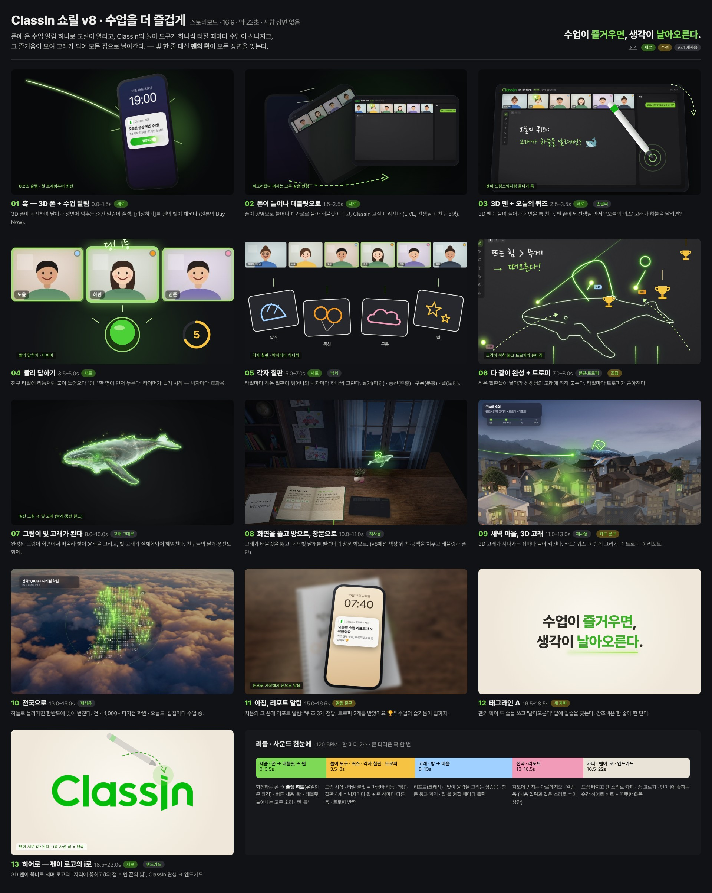

# 06. v8 기획 — 수업을 더 즐겁게 (사람 장면 없음, 16:9, 약 22초)

v7.1(`../classin-showreel/`)은 그대로 두고, 이 폴더(`classin-showreel-v8/`)에서만 다듬는다.

> 스토리보드의 재사용 장면은 v7.1 실제 렌더 스틸, 새 장면은 구성 확인용 목업이다.

## 한 줄 콘셉트
> 폰에 온 수업 알림 하나로 교실이 열리고, ClassIn의 놀이 도구가 하나씩 터질 때마다 수업이 신나지고, 그 즐거움이 모여 고래가 되어 모든 집으로 날아간다.

- 원본(Amazon)이 폰 → 검색 → 주문 → 배송으로 제품이 하는 일을 분명히 보여줬듯, **폰 → 태블릿 → 펜 → 놀이 도구 → 리포트**로 ClassIn이 하는 일을 보여준다.
- 원본의 "빛 한 줄" 역할은 **펜의 획**이 맡는다. 쓰고, 버튼을 채우고, 고래를 그리고, 집을 잇고, 카피를 쓰고, 마지막에 로고의 i가 된다 (i의 사선 끝 = 펜촉).
- 태그라인: **수업이 즐거우면, / 생각이 날아오른다.** (강조: 즐거우면 / 날아오른다)

## 확정 사항
| 항목 | 결정 |
|---|---|
| 테마 | 수업을 더 즐겁게 |
| 사람 | 사람 장면 없음. 교실 화면의 일러스트 타일은 UI로 유지 |
| 태그라인 | A — 수업이 즐거우면, 생각이 날아오른다. |
| 놀이 도구 | 빨리 답하기 · 각자 칠판 · 트로피 (+ 타이머) |
| 고래 | v7.1 빛 고래·3D 고래 그대로 클라이맥스로 |
| 고래가 멈추는 장면 | 삭제 (처음부터 함께라 처음부터 난다) |

## 장면 구성
| # | 시간 | 장면 | 소스 |
|---|---|---|---|
| 1 | 0.0–1.5 | 3D 폰이 회전하며 날아와 정면에 멈추는 순간 알림 슬램: `오늘은 상상 퀴즈 수업!` → [입장하기]를 펜의 빛이 채움 | 새로 |
| 2 | 1.5–2.5 | 폰이 고무처럼 늘어나며 가로로 돌아 태블릿, ClassIn 교실 켜짐 | 새로 + 교실 UI |
| 3 | 2.5–3.5 | 3D 펜이 드럼스틱처럼 돌며 화면을 톡 → 판서 `오늘의 퀴즈: 고래가 하늘을 날려면? 🐋` | 새로 + 손글씨 |
| 4 | 3.5–5.0 | 빨리 답하기: 타일에 리듬처럼 불 → "딩!" 1등, 타이머 시작 | 새로 |
| 5 | 5.0–7.0 | 각자 칠판: 박자마다 날개(파랑)·풍선(주황)·구름(분홍)·별(노랑) | 새로 + 낙서 |
| 6 | 7.0–8.0 | 작은 칠판들이 선생님의 고래에 착착 붙고 트로피가 쏟아짐 | 칠판·트로피 + 조립 |
| 7 | 8.0–10.0 | 그림이 화면에서 떠올라 빛이 윤곽을 그리고 빛 고래가 실체화 | **고래 그대로** |
| 8 | 10.0–11.0 | 태블릿을 뚫고 방으로 → 창문 (책상 위 책·공책은 치우고 태블릿·폰만) | 재사용 + 정리 |
| 9 | 11.0–13.0 | 새벽 마을, 3D 고래, 집마다 불. 카드 `퀴즈 → 함께 그리기 → 트로피 → 리포트` | 재사용 + 카드 문구 |
| 10 | 13.0–15.0 | 전국 지도: `전국 1,000+ 다지점 학원` | 재사용 |
| 11 | 15.0–16.5 | 처음의 폰에 리포트 알림: `퀴즈 3개 정답, 트로피 2개를 받았어요 🏆` | 알림 문구 수정 |
| 12 | 16.5–18.5 | 태그라인 A | 새 카피 |
| 13 | 18.5–22.0 | 3D 펜이 서며 로고의 i가 되고 ClassIn 완성 → 엔드카드 | 새로 + 엔드카드 |

## 살리는 것 / 버리는 것
- **살림**: 빛 고래(윤곽·실체화·헤엄·반짝이), 칠판 낙서, 방 → 창문 비행, 새벽 마을 + 3D 고래, 전국 지도, 알림, 태그라인 연출, 엔드카드, 음악 엔진, 시간 워프
- **버림**: 오프닝 혜성 + 로고 슬램, 밤의 책상과 책 넘김, 책에서 단어가 떠오르는 장면, 고래가 멈추는 장면, 아침 공책 도장

## 룩 · 모션 · 소리
- **모션**: 통통 튀게 — 찌그러졌다 펴지는 변형, 살짝 튀어 오르는 등장, 드럼스틱처럼 도는 펜. 큰 타격은 훅 한 번만.
- **색**: 초록이 주인공, 친구 넷의 펜 색(파랑 #9FD0FF · 주황 #F59A23 · 분홍 #F29BB8 · 노랑 #F6C343)은 보조 액센트.
- **소리 (120 BPM)**: 마림바·박수·팝 추가. 도구가 터질 때마다 박자 위 효과음, 칠판 4개는 펜 색마다 다른 음. 리포트 알림은 첫 알림과 같은 소리로 수미상관. 펜이 i에 꽂히는 순간 히어로 히트.

## 만드는 방법
- 3D 폰 → 태블릿 변형, 3D 펜, 펜 → i: 렌더러에 three.js(WebGL)를 버전 고정으로 넣어 같은 결정론적 render(t) 안에서 그린다. 정지 시 로고는 항상 공식 평면 로고.
- 나머지는 v7.1 씬을 재사용하고 연결만 바꾼다. 이미지 생성은 거의 필요 없음.

## 확인 필요
- 놀이 도구의 화면 문구(빨리 답하기 · 각자 칠판 · 트로피 · 타이머)를 **ClassIn 한국어판 실제 명칭**에 맞출 것.

## 다음 단계
1. 스토리보드 확인 → 수정 반영
2. three.js 도입 + 3D 폰/펜 룩 테스트 스틸
3. 새 장면 구현(1–6, 11–13) → 재사용 장면 연결(7–10)
4. 사운드 → 풀 렌더 → 검증 → 전달
