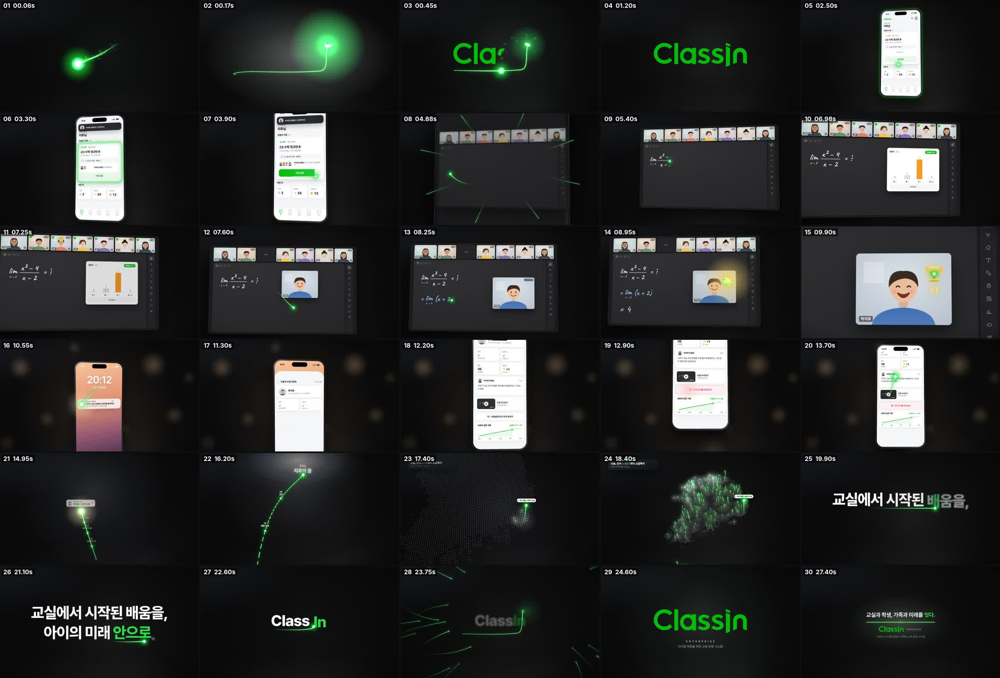
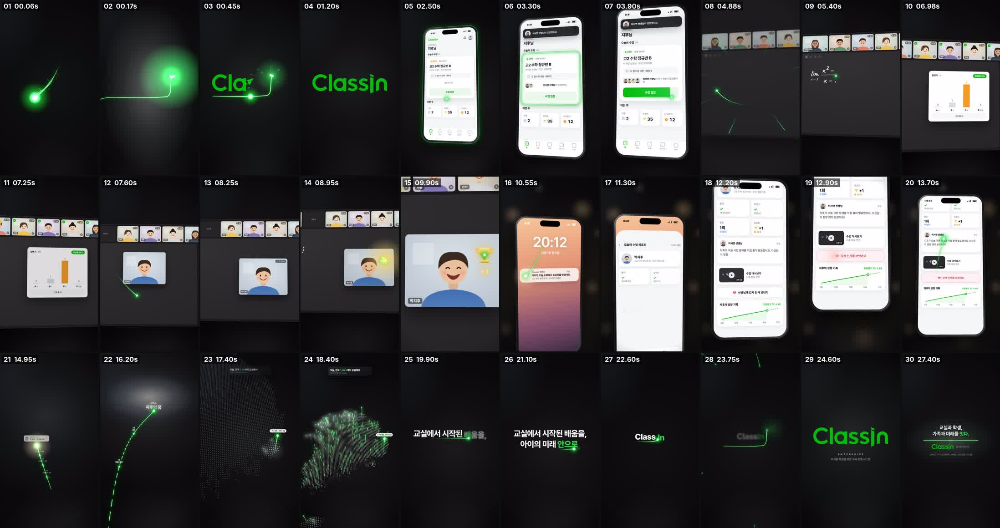

# 03. 최종 대본 · 스토리보드 (v4) — 「Class, In.」 교실 · 학생 · 가족 · 미래

- 길이 **28.8s** = 100BPM 12마디 (1마디 = 2.4s) → 본편 26.4s + 엔드카드 2.4s
- 포맷 60fps · 16:9(1920×1080) 마스터 + 9:16(1080×1920) 리레이아웃
- 원 테이크 / 하드컷 0 — 씬이 바뀔 때마다 **빛이 직접 다음 씬으로 들어간다**
- 타이밍의 단일 소스: [`src/timeline.json`](../src/timeline.json) (영상·사운드가 같은 파일을 읽음)

## 스토리라인
> **교실**에서 시작된 한 줄의 빛이 **학생**의 순간이 되고, **가족**에게 닿아 고마움이 되고, 아이의 **미래**로 이어진다.
> 그리고 그 빛은 오늘 전국의 모든 교실에서 솟는다. — 교실(Class)에서 시작된 배움을, 아이의 미래 안(In)으로. **ClassIn**.

| 축 | 장면 | ClassIn의 실제 기능으로 증명 |
|---|---|---|
| 교실 | 학생 앱 → 수업 입장 → ClassIn 교실 | 수업 카드, 입장 알림, 다중 페이지 칠판, 영상 좌석, 툴바, **답변기**, **손들기**, **무대 올리기**, **판서 권한**, **트로피** |
| 학생 | 지후의 첫 발표, 트로피 +1, 웃는 얼굴 클로즈업 | 좌석의 트로피 개수 35 → 36 |
| 가족 | 엄마 폰: 알림 → 오늘의 수업 리포트 → 감사 인사 | 학부모 알림, 출석·답변기·발표·트로피 리포트, 선생님 코멘트, **수업 다시보기**, 성장 기록 |
| 미래 | 72 → 80 → 88 → 오늘 → 미분 → 고3 → 지후의 꿈 | 학습 데이터가 쌓여 만드는 성장 경로 |
| 모두 | 전국 지도에서 모든 교실의 빛기둥이 솟음 | 1,000+ 다지점 학원, 오늘 1,024개의 교실 |

## 세 가지 기준
| 기준 | 영상 안에서의 약속 |
|---|---|
| **초록은 포인트만** | 무대는 뉴트럴 차콜(#0A0A0B), 교실 UI는 ClassIn의 차콜 칠판, 앱은 화이트 UI. 초록은 **빛 한 줄 · 공식 로고 · 핵심 버튼/정답 체크**에만. 보조색은 ClassIn UI에서 가져옴: 정답 주황, 손들기 노랑, 트로피 금색, 학생 판서 하늘색 |
| **부드러운 연결** | 60fps + 서브프레임 모션블러, 긴 이징, 하드컷 0. 프레임 차이 분석으로 튐 검증 |
| **감정 → 브랜드** | 장면마다 빛의 온도가 바뀜: 교실(뉴트럴 쿨) → 집(따뜻한 앰버 보케) → 미래(새벽빛) → 로고. 숨 고르기에서 모든 연결선이 `i` 점으로 모여 로고가 됨 |

---

## 비트 시트

### S1 · SLAM — 0.00–1.60 (마디 0)
| 시간 | 비주얼 | 빛 | 사운드 |
|---|---|---|---|
| 0.00 | 프레임 0부터 혜성 같은 빛줄기(가닥 3개 + 빛 먼지)가 돌진 | 접근 | 리버스 스웰 |
| **0.17** | `i` 점에 **슬램** + 셰이크 + 파편 | 슬램 | 서브 히트 |
| 0.23–0.67 | 빛이 Class → In으로 달리며 공식 로고를 사선 마스크로 리빌, 이후 정지(픽셀 정확) | 화살표 | 스와이프 |

### S2 · 입장 — 1.60–4.80 (마디 1) *지후의 폰, ClassIn 학생 앱(라이트 UI)*
| 시간 | 비주얼 | 빛 | 사운드 |
|---|---|---|---|
| 1.75 | 로고가 빠지며 `i` 점의 빛 사본이 떨어짐 | 낙하 | 휘시 |
| **2.40** | 지후의 폰이 박자에 착지: "안녕하세요, 지후님" / 오늘의 수업 `고2 수학 정규반 B · 이서연 선생님 · 부산 센텀지점` | 카드 외곽 트레이스 | 착지 |
| 3.05–3.45 | 토스트 "이서연 선생님이 입장했어요", 라이브 배지 `곧 시작 → LIVE`, 선생님·친구 아바타가 하나씩 | — | 알림 · 팝 ×4 |
| 3.60–4.05 | 빛이 `수업 입장` 버튼의 **채움**이 됨 | 버튼 fill | 라이저 |
| 4.10 | 탭 → `입장 중…` 스피너 | — | 클릭 |
| 4.45–4.85 | 화면이 차콜로 어두워지며 프레임을 가득 채움 → 그 안에서 교실이 맺힘 | 방사형 스트릭 | 휘시 |

### S3 · 교실 → 학생 — 4.80–10.20 (마디 2–4) *ClassIn 교실(차콜 칠판, UI는 공식 화면 기준 재현)*
| 시간 | 비주얼 | 빛 | 사운드 |
|---|---|---|---|
| **4.80** | **드롭**: 상단 영상 좌석 7개(이서연 선생님 + 학생 6, 좌석마다 트로피 수), 다중 페이지 칠판, 우측 툴바 | 화면에서 칠판으로 | 드롭(킥 시작) |
| 4.95–5.75 | 선생님 판서: `lim (x→2) (x²−4)/(x−2) = ?` | **선생님의 펜 끝** | 분필 |
| 5.85–6.95 | **답변기 Q1**: 좌석마다 제출 체크(6/6), 막대 상승, 정답 `C 4`가 **주황**으로, `정답률 83%` | — | 팝 · 틱 ×6 · 차임 |
| 7.15 | 지후가 **손들기**(노란 손) | — | 팝 |
| 7.35–7.80 | 지후의 영상 타일이 좌석에서 칠판 위 **무대**로 날아오름(초록 활성 테두리), 빈 좌석엔 `무대 위` | 타일을 실어 나름 | 스와이프 |
| 7.90–8.45 | `판서 권한` → 지후가 직접 풀이 `= lim (x+2) = 4` (하늘색 판서) | **지후의 펜 끝** | 분필 |
| 8.55–8.88 | 선생님 좌석에서 지후에게 빛이 날아가 **금빛 트로피 +1**, 좌석 트로피 35 → 36, 지후가 활짝 웃음 | **보상** | 리워드 차임 |
| 9.00–10.20 | 지후의 얼굴로 클로즈업 — 트로피에서 불꽃이 위로 떠오름 | 상승 | 휘시 |

### S4 · 가족 — 10.20–14.40 (마디 4–5) *엄마의 폰, 따뜻한 집 조명*
| 시간 | 비주얼 | 빛 | 사운드 |
|---|---|---|---|
| 10.20 | 따뜻한 보케, 잠금화면 20:12 | 불꽃이 내려옴 | 시머 |
| 10.45 | 알림: `ClassIn 학부모 · 지후가 오늘 수업에서 트로피를 받았어요` | **알림을 배달** | 알림 |
| 10.95–11.35 | 탭 → **오늘의 수업 리포트**: 출석 ✓ 18:58 · 답변기 정답(C) · 발표 1회 **첫 발표!** · 트로피 +1 (총 36개) | — | 클릭 |
| 11.50–12.35 | 선생님 코멘트가 타이핑: "지후가 오늘 극한 문제를 직접 풀어 발표했어요. 자신감이 정말 많이 늘었어요!" | — | 타이핑 틱 · **리프트(12.0)** |
| 12.10 | **수업 다시보기** · 지후 발표 장면 24:13 | — | 팝 |
| 12.75–12.90 | `선생님께 감사 인사 보내기` → `감사 인사를 보냈어요` ♥ | — | 클릭 · 플럭 |
| 13.10–14.40 | 하트가 빛이 되어 위로, 화면은 **지후의 성장 기록**(72 → 88, 점선은 '다음')을 지나며 스크롤 | **하트 → 빛** | 휘시 |

### S5 · 미래 — 14.40–17.00 (마디 6) *새벽빛*
| 시간 | 비주얼 | 빛 | 사운드 |
|---|---|---|---|
| 14.40–14.95 | 원근 바닥 위로 경로가 그려짐: 9월 72 · 10월 80 · 11월 88 | **과거 = 실선** | 지퍼 · 플럭 ×3 |
| 14.95 | `12월 1일 · 오늘 — 첫 발표 · 트로피 36` (지후 아바타 카드) | 오늘 = 빛나는 노드 | 차임 |
| 15.20–16.50 | 빛이 **점선**으로 지평선을 향해: `1월 미분 시작` · `3월 고3` · **`그리고, 지후의 꿈`**, 지평선에 새벽빛 | **미래 = 점선** | 에어 · 플럭 ×3 |
| 16.50–17.00 | 카메라가 위로 크레인업 | — | 휘시 |

### S6 · 모두 — 16.90–19.20 (마디 7)
| 시간 | 비주얼 | 빛 | 사운드 |
|---|---|---|---|
| 16.90 | 한국 도트맵, 부산의 빛 하나: `부산 센텀 · 지후의 교실` | 내려앉음 | 시머 |
| 17.20–18.60 | 부산에서 퍼져 나가며 **전국 모든 교실에서 빛기둥**이 솟음, 카드 `오늘, 전국 1,024개의 교실에서 · 1,000+ 다지점 학원` | 빛기둥 ×213 | 플럭 ×14 |
| 18.85–19.20 | 가장 밝은 빛(지후의 교실)이 카메라로 떠올라 화면 중앙으로 | **리프트오프** | 휘시 |

### S7 · Class, In — 19.20–24.00 (마디 8–9)
| 시간 | 비주얼 | 빛 | 사운드 |
|---|---|---|---|
| 19.20–20.15 | 빛이 1행 아래를 지나가며 한 단어씩 써 나감: `교실에서 시작된 배움을,` | **쓰는 빛** | 스와이프 |
| 20.15–20.72 | 스웁해서 2행: `아이의 미래` | 쓰는 빛 | 스와이프 |
| 20.72–21.30 | 같은 빛이 그대로 `안으로` 밑줄 (초록) | 밑줄 | 스와이프 |
| 21.60–22.20 | 재구성: `교실` → **Class**, `안으로` → **In** | — | 시머 |
| 22.20–22.80 | Class + In이 미끄러져 붙음, 빛이 아래를 달려 `i`에서 꺾임 | Class→In 화살표 | 스와이프 |
| 23.40–24.00 | **숨 고르기**: 음악 아웃, 사방에서 34개의 빛줄기(영상 속 모든 연결)가 `i` 점으로 수렴 | **수렴** | 리버스 스웰 · 수렴 스웰 |

### S8 · 히어로 — 24.00–26.40 (마디 10)
| 시간 | 비주얼 | 사운드 |
|---|---|---|
| **24.00** | **히트**: 빛이 공식 로고 `i` 점에 슬롯인, C → n 리빌 → 정지(픽셀 정확) | 로우 히트 + 풀 코드 |
| 24.30 | `ENTERPRISE` · `다지점 학원을 위한 교육 운영 시스템` | |
| 24.80–25.80 | 로고 아래로 느린 빛 | 에어 |

### S9 · 엔드카드 — 26.40–28.80 (마디 11)
| 시간 | 비주얼 | 사운드 |
|---|---|---|
| 26.35–26.80 | `i` 점의 빛 → 점 → 가로 빛의 선 | 핑 · 지퍼 |
| 26.80– | 선 위 **"교실과 학생, 가족과 미래를 잇다."** / 선 아래 공식 로고 + ENTERPRISE / `1,000+ 다지점 학원이 선택한 교육 운영 시스템` | 코드 잔향 |

---

## VO 대본 (선택 — 녹음 후 `render/vo/vo_01.wav …` 로 넣으면 자동 배치, 음악은 단어 아래로 12dB 이상 덕킹)
| 파일 | 시작 | 대사 |
|---|---|---|
| vo_01 | 0.50 | 배움은 교실에서 시작됩니다. |
| vo_02 | 4.90 | 질문하고, |
| vo_03 | 6.40 | 답하고, |
| vo_04 | 7.40 | 한 걸음 앞으로. |
| vo_05 | 8.90 | 그 순간이, |
| vo_06 | 10.50 | 가족에게 닿고, |
| vo_07 | 12.80 | 고마움이 되어, |
| vo_08 | 14.60 | 아이의 내일을 만듭니다. |
| vo_09 | 17.20 | 오늘, 전국의 모든 교실에서. |
| vo_10 | 19.40 | 교실에서 시작된 배움을, |
| vo_11 | 20.40 | 아이의 미래 안으로. |
| vo_12 | 24.20 | 클래스인. |

## 음악 (코드로 합성한 오리지널, 100BPM D장조)
| 마디 | 0 | 1 | 2 | 3 | 4 | 5 | 6 | 7 | 8 | 9 | 10 | 11 |
|---|---|---|---|---|---|---|---|---|---|---|---|---|
| 장면 | 로고 | 입장 | 교실 | 교실 | 트로피 | 가족 | 미래 | 전국 | 태그 | 숨 | 히어로 | 엔드 |
| 코드 | Dadd9 | Bm7 | Gmaj7 | A | Bm7 | Gmaj7 | D | A | Em7 | Asus4 | Dadd9 | Dadd9 |
| 리듬 | 키·패드 | 키·패드 | **드롭** 킥·클랩·햇 | | | **리프트** 16분 햇 | | | 킥 아웃(햇만) | 23.4 음악 아웃 | 풀 코드 + 로우 히트 | 잔향 |

## 스토리보드 프레임 (렌더러로 뽑은 실제 키프레임)

세로판: 
