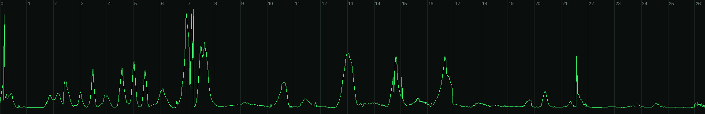
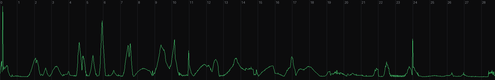

# 04. 수정 · 디벨롭 로그

리뷰 방법(원본 프롬프트의 PROCESS 5 그대로): 결정론적 렌더러라 아무 시점이나 즉시 뽑을 수 있다 →
**0.5s 간격 컨택트시트(53장)** 로 전체 흐름 점검 → 문제 구간만 **스틸 클로즈업** → 수정 → 재확인.
풀 렌더 후에는 **프레임 간 차이(움직임 에너지) 그래프**로 팝/튐/계단식 모션블러를 찾는다.

---

## v0 → v1 · 빌드 중 발견한 문제

| # | 증상 | 원인 | 수정 |
|---|---|---|---|
| 1 | 콘솔 씬 카메라가 기기 좌상단만 비춤 | 숨겨진(`display:none`) 씬에서 레이아웃을 측정해 좌표가 전부 0 | 측정 시 모든 씬을 잠깐 표시하고 `layout()` 호출 (`film.js`) |
| 2 | 맵의 배포 경로가 "분수"처럼 과하게 솟음 | 아치 높이 `40 + d·0.28` | `10 + d·0.11`로 낮추고 소형 지점은 얇고 어둡게(위계) |
| 3 | 맵 → 교실 전환에서 맵의 빛줄기가 블러 없이 남음 | 빛은 전역 캔버스라 씬의 블러/페이드 필터를 받지 않음 | 맵 페이드 구간을 앞당기고(10.42–10.80) 다이브 플레어 축소 |
| 4 | "전 지점에 배포"와 "배포되었습니다"가 겹쳐 보임 | 크로스페이드 구간 중첩 | 라벨은 먼저 빠지고(−0.04→+0.05) 성공 문구는 뒤에 들어오게 분리 |
| 5 | 태그라인 · 엔드카드 글자가 폰에서 작음 | 112px / 40px | 148px / 54px, 서브라인 31px, 엔드카드 로고는 240px 원본 크기(픽셀 정확) |

## v1 → v2 · 전체 컨택트시트 리뷰

| # | 구간 | 증상 | 수정 |
|---|---|---|---|
| 1 | 0.00 | **훅이 약함** — 프레임 0이 화면 중앙의 작은 점 | 접근 경로를 카메라 가까이로 당기고(머리 시작 30% 지점), 가닥 3개 굵기·진폭 확대, 꼬리에 빛 먼지 26개. 프레임 0부터 큰 혜성이 화면을 가로지름 |
| 2 | 0.16 | 슬램 직전 꼬리가 올가미처럼 말림 | 접근 곡선의 마지막 제어점을 베이스라인과 평행하게 → 매끈하게 화살표로 합류 |
| 3 | 0.70–1.05 | 정지한 로고 위에 i-점 잔광이 남음 (브랜드 규칙 위반) | 잔광을 1.02s 전에 완전히 소거 → 정지 구간은 공식 로고만 |
| 4 | 17.0–18.0 | 태그라인 글자가 탁하고 회색 (어두운 UI 이미지로 글자 채움) | 이미지 채움 폐기 → 줄 단위로 **그린-화이트 빛 밴드가 스윕**하고 순백으로 정착 |
| 5 | 8.4–10.4 | 도트맵이 어둡고 작아 한국 지형이 잘 안 읽힘 | 도트 알파 0.42→0.58, 크기 3.4→3.9, 카메라 스케일 0.84→0.96 |
| 6 | 5.6–6.6 | 배포 버튼이 화면 중앙 + 하단 절반이 빔 | 버튼을 하단 1/3로, 위쪽은 체크된 지점 리스트가 채우도록 카메라 타깃 이동 |
| 7 | 6.03 | 탭 리플이 흰 덩어리처럼 글자를 가림 | 리플을 얇은 링 + 약한 채움으로 |

## v2 · 9:16 리레이아웃 (크롭 아님)

가로 UI를 세로 화면에 그대로 넣으면 화면의 1/3만 차지 → 세로판 전용 카메라 키를 따로 설계.

| 씬 | 16:9 | 9:16 |
|---|---|---|
| 콘솔 타이핑 | 기기 전체 + 입력창 (s 1.36) | 입력창 왼쪽 + 자동완성만 크게 (s 1.9) |
| 카드 팬 | 가로로 넓은 부채꼴 | 세로로 좁은 부채꼴 (FAN 좌표 별도) |
| 배포 버튼 | s 1.8 | s 2.35, 버튼 하단 1/3 |
| 전국 맵 | 트래커 좌상단, 맵 우측 | 트래커 상단 중앙, 맵이 하단 2/3를 꽉 채움 (한국 지형은 원래 세로형) |
| 교실 | 패널 전체 | 판서 쪽으로 밀착 (s 1.42, x −230) |
| 16개 교실 월 | 4×4 전체 | 2.5열이 화면을 넘치게 → "끝없이 이어지는 교실" |
| 대시보드 | 전체 | KPI + 차트 좌측 밀착 (s 1.2) |
| 태그라인 | 148px | 108px, 같은 2줄 |
| 엔드카드 | 1줄 | "1,000개 이상의 다지점 학원이 / 선택한 교육 운영 시스템" 2줄 |

## v2 → v3 · 클라이언트 피드백: "부드러운 프레임 · 고급스러운 연결 · 고객과의 연결이 감정으로 로고까지"

### ① 부드러운 프레임 — 프레임 차이 분석으로 검증
렌더된 60fps 영상의 연속 프레임 차이(움직임 에너지)를 전 구간 측정. 부드러운 언덕 = 긴 이징, 뾰족한 봉우리 = 튐/컷.

| 구간 | v2 측정 | 원인 | v3 수정 |
|---|---|---|---|
| 0.17 | 봉우리 | 의도된 슬램(훅) | 유지 |
| **7.267** | **유일한 튐 (diff 14.4, 이웃 6.4)** | 콘솔 씬이 7.25에 꺼지면서 플래시·관통 빛줄기가 1프레임에 사라짐 | 씬 범위 7.36까지 연장, 빛줄기·플레어를 7.12–7.34에 걸쳐 소멸 |
| 14.9–15.05 | 작은 튐 | 교실→대시보드에서 수렴선이 씬 종료와 함께 사라짐 | 14.90–15.03 페이드 |
| 16.95 | 빠른 푸시가 급정지 | 대시보드가 최고 속도에서 꺼짐 | 16.55부터 깊은 블러로 먼저 빠지고, 빛 머리가 다음 씬으로 이어짐 |
| 21.60 | 봉우리 | 의도된 히어로 히트 | 유지 |
| 파일 | 130MB (38Mbps, 그레인) | | 그레인 7→4, CRF 19 + VBV 10Mbps 상한 |

### ② 고급스러운 연결 — 빛이 끊기는 곳을 없앰
| 이음매 | v2 | v3 |
|---|---|---|
| 맵 → 교실 | 부산 플레어가 꺼지고, 0.4초 뒤 화면 밖에서 새 빛이 들어옴 | **다이브 지점(화면 중앙)에서 빛이 그대로 이어져** 패널 밑으로 빠졌다가 감기 시작 |
| 대시보드 → 태그라인 | 차트 머리로 푸시 후 암전, 1.4초 뒤 밑줄에서 빛 재등장 | 차트의 빛 머리가 중앙에 남아 **1행·2행 글자를 한 단어씩 써 나가고**, 그대로 `안으로` 밑줄이 됨. 시즌 밴드는 빛의 위치를 따라감 |
| 교실 → 대시보드 | 수렴선이 씬과 함께 툭 사라짐 | 플레어로 모인 뒤 페이드 |

### ③ 고객과의 연결 → 감정 → 로고
v2는 감정의 정점(학생 정답, 12.0s)이 로고(21.6s)에서 너무 멀고, 그 사이를 데이터 화면이 채웠다.

| 추가한 비트 | 시간 | 의도 |
|---|---|---|
| **트로피 보상** — 정답 밑줄에서 불꽃이 학생 타일로 날아가 금빛 트로피 +1 (ClassIn 고유 기능), 카메라가 학생에게 다가감 | 12.08–12.75 | 시스템 이야기가 **한 아이**에게 도착하는 순간 |
| **학부모 알림** — "지후가 오늘 수업에서 트로피를 받았어요"가 본사 알림 아래로 쌓임 | 13.88 | 같은 순간이 **본사와 가족** 모두에게 — 고객(학원)의 고객(학부모)까지 연결 |
| **연결선 수렴** — 숨 고르기 동안 사방에서 34개의 빛줄기가 `i` 점으로 모임 | 21.02–21.60 | 영상 속 모든 연결(지점·교실·학생·가족)이 **로고로 모이는 감정의 들숨** → 히트에서 터짐 |
| **엔드카드 카피** "본사와 지점, 선생님과 학생을 하나로." | 24.4– | 정보(1,000+)는 서브로 내리고, 마지막 문장은 연결의 약속 |
| VO 대본 | — | "그리고 한 아이의 순간까지." / "모두, 하나로 연결됩니다." 추가 |

## v3 → v4 · 클라이언트 피드백: "초록은 포인트만 · ClassIn 실제 소스/앱 UI 반영 · 교실·학생·가족·미래를 잇는 스토리"

### ① 초록은 포인트 컬러로만
v3까지는 무대 글로우·코너·UI 패널·도트맵·플래시가 모두 초록 계열이라 화면 전체가 초록으로 덮였다.

| 요소 | v3 | v4 |
|---|---|---|
| 무대 | #050806 + 초록 글로우 + 딥그린 코너 | **#0A0A0B 뉴트럴 차콜** + 장면별 색온도 글로우(교실 뉴트럴 쿨 / 집 앰버 / 미래 새벽빛), 슬레이트 코너 |
| 교실 UI | 초록빛 칠판 | ClassIn 공식 화면의 **차콜 칠판**(#2A2A2D), 회색 좌석 |
| 앱 UI | 다크 그린 콘솔 | ClassIn 앱의 **화이트 UI** (어두운 무대 위 밝은 주인공) |
| 도트맵 | 초록 도트 | 뉴트럴 그레이 도트, 빛이 닿으면 흰색 |
| 보조색 | 없음 | ClassIn UI에서: 정답 **주황**, 손들기 **노랑**, 트로피 **금색**, 학생 판서 **하늘색**, 감사 **핑크** |
| 초록이 남은 곳 | 전부 | 빛 한 줄 · 공식 로고 · `수업 입장` 버튼 · 정답 체크 · `안으로` 한 단어 |

### ② ClassIn 실제 제품 UI 반영
레포의 기존 이미지(범용 AI 대시보드·뇌 이미지)는 ClassIn 제품이 아니어서, ClassIn 공식 사이트(classin.com/teachers, 홈)의 제품 화면과 공식 기능 설명을 조사해 **코드로 다시 그렸다**(사진·이미지는 사용하지 않음, 인물은 모두 가상의 일러스트).

| ClassIn 공식 화면/기능 | 영상 속 재현 |
|---|---|
| 차콜 칠판 + 상단 영상 좌석 + 우측 세로 툴바 | S3 교실 전체 레이아웃 |
| 무대(Stage)에 학생을 크게 올림, 활성 초록 테두리 | 지후의 타일이 좌석에서 칠판 위로 |
| 퀴즈 결과: 막대 A–D, 정답 주황, Accuracy, Submission | 답변기 Q1 · 정답률 83% · 제출 6/6 |
| 트로피 보상(시상대, 금·은·동) | 선생님 → 지후 트로피 +1, 좌석 트로피 수 |
| 손들기 · 판서 권한 · 다중 페이지 칠판 · 클라우드/타이머/주사위 도구 | 노란 손, `판서 권한` 배지, 페이지 탭 1·2·3·+, 툴바 아이콘 |
| 수업 녹화 라이브러리 · 출석/수업활동/과제 데이터 · 학부모 리포트 | 학부모 리포트(출석·답변기·발표·트로피·코멘트·다시보기·성장 기록) |

### ③ 스토리라인 재구성 — 본사 시스템 → 교실 · 학생 · 가족 · 미래
| v3 (본사 중심) | v4 (사람 중심) |
|---|---|
| 본사 콘솔에서 커리큘럼 배포 | **지후의 폰**: 오늘의 수업, 선생님·친구 입장, `수업 입장` |
| 전국 배포 경로 | (뒤로 이동) **모든 교실에서 솟는 빛기둥** — 한 아이의 이야기가 전국의 이야기가 됨 |
| 교실 + 16개 교실 월 | **ClassIn 교실**: 판서 → 답변기 → 손들기 → 무대 → 직접 풀이 → 트로피 |
| 본사 대시보드 | **가족**: 엄마의 폰, 리포트, 선생님 코멘트, 다시보기, 감사 인사 |
| — | **미래**: 72 → 80 → 88 → 오늘 → 미분 → 고3 → 지후의 꿈 |
| "모든 수업을, 하나의 시스템 안으로." | **"교실에서 시작된 배움을, 아이의 미래 안으로."** (교실 → Class, 안으로 → In) |
| "본사와 지점, 선생님과 학생을 하나로." | **"교실과 학생, 가족과 미래를 잇다."** |

빛의 역할도 사람을 따라간다: 선생님의 펜 끝 → 지후의 펜 끝 → 트로피 → 엄마 폰의 알림 → 감사의 하트 → 미래의 경로 → 모든 교실의 빛기둥 → 태그라인을 쓰는 빛 → 로고.

### v4 빌드 중 수정
| 증상 | 수정 |
|---|---|
| 21.6s 이후 Class + In이 보이지 않음 | 태그라인 씬이 v3 타이밍(21.5s)에 꺼지던 것을 히어로 비트 기준으로 |
| 폰 → 교실 전환에서 두 화면이 반투명하게 겹침 | 폰 화면이 먼저 차콜로 어두워지며 프레임을 채우고, 교실은 그 안에서 맺히도록 순서 분리 |
| 교실 → 가족에서 지후 얼굴 위로 폰이 겹침 | 교실이 10.18s에 완전히 빠진 뒤 가족 시작, 이음매는 빛(불꽃)이 담당 |
| 트로피가 지후의 얼굴을 가림 | 타일 오른쪽 위로 이동 |
| "제출 6/6"이 세로로 줄바꿈 | flex 정렬 |
| 리포트 하단이 비어 보임 | **지후의 성장 기록**(72 → 88, 점선 '다음') 추가 — 다음 미래 씬을 미리 암시 |

### v4 최종 검증 — 프레임 차이 분석

- 1,728프레임(28.8s × 60fps), 튐 검출 **1곳: 0.167s = 의도된 슬램 훅**. 그 외 모든 움직임은 언덕형(긴 이징) 곡선.
- 흰 카드가 어두운 화면에 들어오는 두 지점(5.85s 답변기, 10.95s 리포트 열림)이 상대적으로 날카로워 페이드 0.12→0.27s, 슬라이드 0.38→0.52s(inOutCubic)로 완화 후 해당 구간만 재렌더.
- 60fps 고정(avg_frame_rate 60/1), 라우드니스 −14.1 LUFS. 트루피크가 −0.1 dBTP로 높아 loudnorm 뒤에 리미터(−1.5 dB) 추가.
